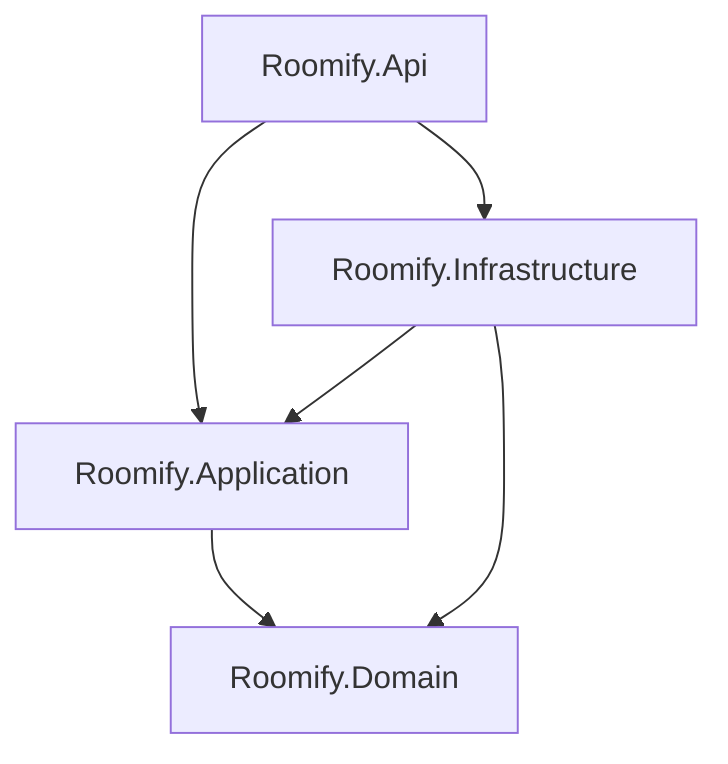

# Backend Roomify — WP-01.2

## Zakres

Istnieje szkielet ASP.NET Core Web API na .NET 10, obsługujący kontrolery MVC, wbudowane DI, konfigurację środowiskową, ILogger i Health Checks. Nie zawiera kontrolerów biznesowych, encji, przypadków użycia, integracji PostgreSQL, EF Core, Identity ani CORS. W WP-01.5 dodano trzy projekty testowe oraz publiczną częściową klasę Program dla WebApplicationFactory; opisuje je [infrastruktura testowa](../testing/README.md). Dokumenty WP-00 pozostają niezmienione.

## Struktura

```text
backend/
├── Roomify.slnx
├── src/
│   ├── Roomify.Api/
│   │   ├── Controllers/.gitkeep
│   │   ├── Properties/launchSettings.json
│   │   ├── Program.cs
│   │   ├── Roomify.Api.csproj
│   │   ├── Roomify.Api.http
│   │   ├── appsettings.json
│   │   └── appsettings.Development.json
│   ├── Roomify.Application/
│   │   ├── ApplicationServiceCollectionExtensions.cs
│   │   └── Roomify.Application.csproj
│   ├── Roomify.Domain/
│   │   └── Roomify.Domain.csproj
│   └── Roomify.Infrastructure/
│       ├── InfrastructureServiceCollectionExtensions.cs
│       └── Roomify.Infrastructure.csproj
└── tests/
    ├── Roomify.Domain.UnitTests/.gitkeep
    ├── Roomify.Application.UnitTests/.gitkeep
    └── Roomify.Api.IntegrationTests/.gitkeep
```

Zachowano początkowe pliki `.gitkeep` z WP-01.1. Katalogi `bin/` i `obj/` powstają lokalnie i są ignorowane przez Git. Drzewo powyżej pokazuje bazę WP-01.2; aktualnie rozwiązanie zawiera cztery projekty produkcyjne i trzy testowe w katalogach `tests/`.

## Warstwy i referencje

| Projekt | Odpowiedzialność docelowa | Bezpośrednie referencje |
|---|---|---|
| Domain | Encje, reguły, typy wartości, statusy niezależne od infrastruktury | Brak |
| Application | Przypadki użycia, DTO, interfejsy, koordynacja domeny | Domain |
| Infrastructure | EF Core, PostgreSQL, Identity, dostęp do danych, migracje | Domain, Application |
| Api | Endpointy HTTP, konfiguracja hosta, middleware, składanie zależności | Application, Infrastructure |

Strzałki oznaczają referencje projektów, a nie przepływ żądania. Zależności są acykliczne.



Wszystkie projekty używają `net10.0`, Nullable Reference Types i Implicit Usings. Domain nie ma kodu ani pakietów. Application i Infrastructure używają wyłącznie `Microsoft.Extensions.DependencyInjection.Abstractions` 10.0.0 dla `IServiceCollection`: minimalnej zależności DI, bez odwołania do całego ASP.NET Core. API korzysta z platformy współdzielonej przez `Microsoft.NET.Sdk.Web`; MVC i Health Checks nie wymagają dodatkowych pakietów.

## Rejestrowanie usług

Dependency Injection polega na przekazywaniu obiektom zależności przez kontener zamiast samodzielnego tworzenia wszystkich zależnych obiektów. `Program.cs` wywołuje `AddApplication()` i `AddInfrastructure()` oraz rejestruje kontrolery, Problem Details i Health Checks.

Obie metody rozszerzeń zwracają na razie ten sam `IServiceCollection`, bez fikcyjnych usług. Rozdzielenie rejestracji pozwoli warstwom deklarować własne implementacje, podczas gdy API pozostanie miejscem składania aplikacji. Domain zawierać będzie niezależne reguły i nie wymaga konfiguracji infrastruktury ani jej rejestracji.

## Obsługa żądania HTTP

1. Kestrel odbiera żądanie na adresie wybranego profilu lub hosta.
2. Middleware tworzą potok wykonywany w kolejności rejestracji. Poza Development standardowy `UseExceptionHandler()` z `AddProblemDetails()` ukrywa szczegóły wyjątków, a `UseHsts()` dodaje politykę HTTPS dla odpowiednich żądań HTTPS.
3. Jeśli skonfigurowano `HTTPS_PORT`, żądanie HTTP jest przekierowywane na HTTPS. Lokalny profil HTTP nie wymaga certyfikatu.
4. `UseRouting()` dopasowuje ścieżkę do endpointu. `MapControllers()` udostępnia przyszłe akcje MVC; obecnie brak kontrolerów, więc nieistniejące ścieżki zwracają 404.
5. `MapHealthChecks("/health")` uruchamia wbudowane Health Checks i zapisuje odpowiedź tekstową.

Docelowo kontroler wywoła przypadek użycia Application, który skoordynuje reguły Domain i interfejsy dostępu do danych. Implementacje Infrastructure obsłużą PostgreSQL. Ten przepływ biznesowy jeszcze nie istnieje.

## Konfiguracja i logowanie

`WebApplication.CreateBuilder(args)` zapewnia konfigurację i wbudowany `ILogger`. Wartości bazowe pochodzą z `appsettings.json`, nadpisuje je `appsettings.{Environment}.json`, następnie zmienne środowiskowe i argumenty CLI. Standardowy host obsługuje też User Secrets w Development, gdy projekt ma taki identyfikator; tutaj go nie dodano.

`appsettings.json` ustala podstawowe poziomy logowania, a `appsettings.Development.json` zwiększa szczegółowość logów ASP.NET Core. Log startowy używa parametryzowanego `ILogger`, bez danych uwierzytelniających. Development pozwala frameworkowi udostępnić szczegóły błędu, więc nie jest środowiskiem do publicznego udostępniania.

`Properties/launchSettings.json` służy lokalnemu uruchamianiu:

- `http`: `http://localhost:5080`, Development, bez certyfikatu.
- `https`: `https://localhost:7080` i `http://localhost:5080`, Development, `ASPNETCORE_HTTPS_PORT=7080`. Wymaga certyfikatu i przekierowuje HTTP na HTTPS.
- Port `8080` jest skonfigurowany w Dockerfile i Compose. Lokalny profil CLI nadal używa `5080`. Konfigurację kontenerową opisuje [DOCKER.md](DOCKER.md); w ponownym odbiorze WP-01.6 potwierdzono działanie API, healthchecka i proxy Nginx po uruchomieniu Docker Desktop. API nadal nie łączy się z bazą.

Nie zapisano connection stringa, hasła ani ustawień bazy. .NET sam nie odczytuje pliku `.env`. Certyfikat można sprawdzić przez `dotnet dev-certs https --check`; jego zaufanie konfiguruje użytkownik. Instrukcje restore, build i uruchamiania znajdują się w [README](../../README.md#uruchamianie-backendu).

## Healthcheck a testy

`GET /health` w profilu HTTP powinien zwrócić `200` i dokładny tekst `Healthy`, bez uwierzytelniania i PostgreSQL. Pusty zestaw kontroli zależności potwierdza wyłącznie obsługę żądania przez aplikację. Profil HTTPS wymaga użycia adresu HTTPS do bezpośredniej kontroli.

| Mechanizm | Cel |
|---|---|
| Healthcheck aplikacji | Bieżąca informacja operacyjna o działaniu hosta; przyszłe kontrole mogą monitorować zależności |
| Test jednostkowy | Izolowane sprawdzenie logiki bez prawdziwej bazy i sieci |
| Test integracyjny | Sprawdzenie współpracy API i infrastruktury, docelowo z rzeczywistym PostgreSQL |

Ręczne żądanie do `/health` w WP-01.2 jest kontrolą techniczną uruchomienia; nie jest wykonaniem przyszłego zestawu testów jednostkowych lub integracyjnych.

## Testowalność i punkty rozszerzeń

Domain bez zależności od HTTP i bazy umożliwi izolowane testowanie reguł. Application będzie korzystać z interfejsów, dla których można później użyć Moq. Od WP-01.5 istnieją projekty jednostkowe i integracyjne. Testy HTTP korzystają z WebApplicationFactory bez bazy, a odrębny test Testcontainers sprawdza SELECT 1. Pełna integracja API z PostgreSQL pozostaje przyszła; polecenia opisuje [dokumentacja testów](../testing/README.md).

Punkty rozszerzeń obejmują rejestracje usług, kontrolery i przypadki użycia, EF Core, Identity z cookies oraz dodatkowe kontrole zależności w `/health`. Nie są potrzebne do uruchomienia obecnego szkieletu. Architekturę docelową opisuje [OVERVIEW.md](OVERVIEW.md).
