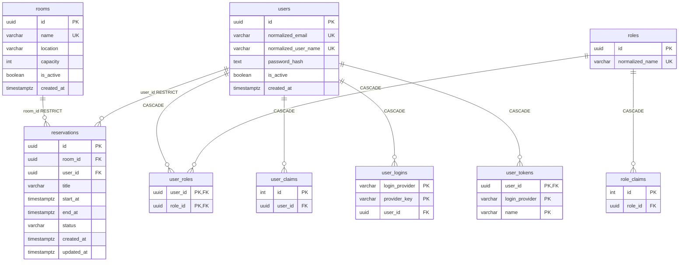

# PostgreSQL i migracje — WP-02.4

Stan zweryfikowany 18.10.2026. PostgreSQL **18.6-bookworm**, EF Core/Identity/Design i lokalne dotnet-ef **10.0.9**, provider Npgsql **10.0.3**. Jedna migracja `20261018093445_InitialCreate` w `backend/src/Roomify.Infrastructure/Persistence/Migrations`. Domain nie zna PostgreSQL ani EF. [Raport wykonania i 30 AC](../testing/WP02_4_REPORT.md).

## 1. ERD

Diagram pokazuje klucze i relacje, nie wszystkie kolumny Identity.



## 2. Tabele biznesowe

`rooms`: `id uuid`, `name varchar(100)` z kolacją ICU, `description text NULL`, `location varchar(150)`, `capacity integer`, `is_active boolean`, `created_at timestamptz`. Pozostałe kolumny NOT NULL. Guid i czas tworzy model; archiwizacja zmienia aktywność, nie usuwa rekordu.

`reservations`: `id`, `room_id`, `user_id` typu uuid; `title varchar(120)`, `start_at` i `end_at timestamptz`, `status varchar(9)`, `created_at timestamptz`, `updated_at timestamptz NULL`. Pozostałe kolumny NOT NULL. Converter zapisuje dokładnie `active` i `cancelled`. `ReservationPeriod` nie ma własnej tabeli: EF mapuje prywatne pola `_startAt`/`_endAt` encji. Npgsql zapisuje wartości UTC; PostgreSQL przechowuje moment, nie oryginalną strefę/offset. Odczyt UTC i historyczna materializacja zostały sprawdzone na serwerze.

## 3. Tabele Identity

| Tabela | Przeznaczenie i PK |
|---|---|
| users | ApplicationUser; `id uuid`. Standardowe pola Identity: nazwy i ich normalizacja, wymagany email/normalized_email, hash hasła, security/concurrency stamp, telefon, potwierdzenia, 2FA, lockout i licznik błędów. Dodatkowo display_name NULL, is_active, created_at. |
| roles | IdentityRole<Guid>; `id uuid`, name/normalized_name varchar(256), concurrency_stamp. |
| user_roles | Powiązania użytkownika i roli; PK `(user_id, role_id)`. |
| user_claims | Roszczenia użytkownika; PK `id integer GENERATED BY DEFAULT AS IDENTITY`. |
| role_claims | Roszczenia roli; analogiczny PK integer. |
| user_logins | Loginy dostawców; PK `(login_provider, provider_key)`, oba varchar(128), FK user_id. Sam schemat nie uruchamia logowania zewnętrznego. |
| user_tokens | Tokeny Identity; PK `(user_id, login_provider, name)`, ostatnie dwa varchar(128), nullable value. |

Nie ma seeda, rzeczywistych kont, haseł ani ról. Użytkownicy techniczni bez hashy powstają tylko w bazach Testcontainers dla integralności FK; nie są implementacją logowania.

## 4. Klucze i relacje

Dziewięć PK modelu oraz osobny PK historii EF. Osiem FK: dwa z reservations do rooms/users z **ON DELETE RESTRICT**, sześć wewnątrz Identity z **ON DELETE CASCADE**. Usunięcie użytkownika mającego rezerwację zostaje odrzucone w całości; historia nie znika wskutek kaskady Identity. PK Guid sal/rezerwacji pochodzą z domeny, użytkowników z ApplicationUser; nie dodano bazowych defaultów UUID/czasu/statusu, które omijałyby inicjalizację aplikacji.

## 5. Indeksy

Poza dziewięcioma indeksami PK modelu i PK historii powstaje jedenaście jawnych indeksów oraz indeks GiST ograniczenia exclusion:

| Nazwa | Kolumny / typ |
|---|---|
| ux_rooms_name | UNIQUE name; ICU `roomify_case_insensitive`, locale `und-u-ks-level2`, nondeterministic. Różna wielkość liter nie pozwala na duplikat. |
| ix_reservations_room_period | B-tree room_id, start_at, end_at |
| ix_reservations_user_start | B-tree user_id, start_at |
| ix_reservations_period | B-tree start_at, end_at |
| ux_users_normalized_email | UNIQUE normalized_email |
| ux_users_normalized_user_name | UNIQUE normalized_user_name |
| ux_roles_normalized_name | UNIQUE normalized_name |
| IX_role_claims_role_id | B-tree role_id |
| IX_user_claims_user_id | B-tree user_id |
| IX_user_logins_user_id | B-tree user_id |
| IX_user_roles_role_id | B-tree role_id |
| ex_reservations_active_period | Częściowy GiST opisany poniżej |

Nazwy `IX_…` zachowują wielkość liter standardowego modelu Identity. Nie dodano indeksów powielających lewe prefiksy kluczy złożonych.

## 6. Ograniczenia integralności

Poza typami, limitami długości, NOT NULL, PK, FK i UNIQUE istnieje sześć CHECK:

| Nazwa | Warunek |
|---|---|
| ck_rooms_capacity_positive | `capacity > 0` |
| ck_rooms_name_not_blank | `btrim(name) <> ''` |
| ck_rooms_location_not_blank | `btrim(location) <> ''` |
| ck_reservations_period | `start_at < end_at` |
| ck_reservations_status | `status IN ('active', 'cancelled')` |
| ck_reservations_title_not_blank | `btrim(title) <> ''` |

`btrim` zabezpiecza pusty tekst i same spacje; pełna normalizacja białych znaków jest w domenie. Nie dodano CHECK używającego aktualnego czasu. Brak bazowych defaultów jest celowy: aplikacja inicjalizuje wartości zgodnie z modelem i kontrolowanym zegarem.

## 7. Exclusion constraint

Jawny SQL w Up, dostosowany do rzeczywistej tabeli i convertera:

```sql
ALTER TABLE public.reservations
ADD CONSTRAINT ex_reservations_active_period
EXCLUDE USING gist
(room_id WITH =, tstzrange(start_at, end_at, '[)') WITH &&)
WHERE (status = 'active');
```

Serwer odrzuca dwa wiersze, gdy jednocześnie mają tę samą salę i przecinające się przedziały. `&&` bada nakładanie, `[)` wyłącza koniec. Predicate obejmuje tylko aktywne rezerwacje; UPDATE również podlega kontroli. Mechanizm działa między transakcjami, nie zależy od zawodnego sprawdzenia SELECT przed INSERT. [Dokumentacja zakresów PostgreSQL 18](https://www.postgresql.org/docs/18/rangetypes.html).

Konfiguracja modelu deklaruje rozszerzenie i CHECK; exclusion jest ręcznym SQL migracji. **Model snapshot nie opisuje tego SQL.** `has-pending-model-changes` nie sprawdza fizycznej obecności exclusion; robią to testy PostgreSQL. Kolejne zmiany nazw/typów/statusów muszą uwzględniać ten obiekt w Up i Down.

## 8. btree_gist

`CREATE EXTENSION IF NOT EXISTS btree_gist` zapewnia klasy operatorów GiST m.in. dla równości UUID room_id obok zakresu czasu. Rozszerzenie jest deklarowane w modelu i powstaje przed exclusion. Migrator wymaga uprawnień do utworzenia rozszerzenia/kolacji ICU/tabel. To osobna czynność administracyjna, nie obowiązek konta API przy każdym starcie. [Dokumentacja btree_gist](https://www.postgresql.org/docs/18/btree-gist.html).

## 9. Przykład terminów

Dla jednej sali aktywne `[09:00,10:00)` i `[09:30,10:30)` kolidują, także identyczne lub całkowicie zawarte przedziały. `[10:00,11:00)` jest dozwolone. Ta sama godzina w innej sali jest dozwolona. Zmiana pierwszej rezerwacji na cancelled zwalnia termin. Godziny ilustrują geometrię zakresów; uprawnienia i lokalny czas operacji nadal weryfikuje aplikacja.

## 10. Rozpoznawanie błędów

Npgsql zwraca `PostgresException.SqlState == "23P01"` (`PostgresErrorCodes.ExclusionViolation`) i `ConstraintName == "ex_reservations_active_period"`. Przy SaveChanges EF opakowuje ten wyjątek w `DbUpdateException.InnerException`; MIG-011 sprawdza obie informacje na realnym serwerze. Przyszła obsługa aplikacyjna ma rozpoznawać konkretny constraint i zwracać neutralny HTTP 409 bez SQL/danych połączenia. Na tym etapie nie dodano kontrolera ani mappera HTTP.

Przy równoczesnych INSERT możliwy jest również **40P01 (deadlock)**: serwer przerywa jedną transakcję, nadal zapewniając brak podwójnego zapisu. To zaobserwowano w regresji WP-02.4. MIG-010 wymaga dokładnie jednego commit, odrzucenia drugiej transakcji kodem 23P01 lub 40P01 i jednego aktywnego wiersza. Nie traktować każdego błędu Npgsql jako konfliktu 409; obsługa ponowień całej transakcji pozostaje do zaprojektowania w serwisie aplikacyjnym. [Mechanizm wykrywania deadlocków](https://www.postgresql.org/docs/18/explicit-locking.html#LOCKING-DEADLOCKS).

## 11. Migracje i fabryka

`InitialCreate.cs`, wygenerowany `.Designer.cs` i `RoomifyDbContextModelSnapshot.cs` są wersjonowanymi źródłami, nie raportami. Up tworzy kolację, rozszerzenie, dziewięć tabel, indeksy, CHECK i exclusion. EF utrzymuje `__EFMigrationsHistory` poza modelem encji. Generowanie skryptu nie stosuje go do bazy.

`RoomifyDesignTimeDbContextFactory` odczytuje zmienne środowiskowe i argumenty przez IConfiguration; współdzieli składanie Npgsql z rejestracją runtime. Nie otwiera połączenia, nie czyta `.env`, nie startuje API ani frontendu, nie migruje automatycznie. Priorytet: `ConnectionStrings__Roomify`, następnie `Database__Host/Port/Name/Username/Password`. Nie podawaj sekretów jako argumentów CLI ani w wersjonowanych plikach. [Tworzenie kontekstu design-time](https://learn.microsoft.com/ef/core/miscellaneous/cli/dbcontext-creation).

## 12. Tworzenie i kontrola migracji

Z katalogu głównego; polecenia działają bez połączenia z bazą:

```powershell
dotnet tool restore
dotnet restore backend/Roomify.slnx
dotnet ef migrations list --no-connect --project backend/src/Roomify.Infrastructure --startup-project backend/src/Roomify.Infrastructure
dotnet ef migrations has-pending-model-changes --project backend/src/Roomify.Infrastructure --startup-project backend/src/Roomify.Infrastructure
New-Item -ItemType Directory -Force artifacts | Out-Null
dotnet ef migrations script --project backend/src/Roomify.Infrastructure --startup-project backend/src/Roomify.Infrastructure --output artifacts/initial.sql
# Tylko podczas przygotowywania kolejnej rzeczywiście potrzebnej zmiany:
dotnet ef migrations add NazwaZmiany --project backend/src/Roomify.Infrastructure --startup-project backend/src/Roomify.Infrastructure --output-dir Persistence/Migrations
```

Manifest przypina dotnet-ef 10.0.9 i zachowuje Stryker 5.0.0. Design 10.0.9 jest prywatną zależnością Infrastructure. Wskazanie Infrastructure jako projektu startowego narzędzia korzysta z fabryki, nie uruchamia pipeline API. Przejrzyj wygenerowany SQL, Up/Down oraz snapshot przed zastosowaniem.

## 13. Bezpieczne zastosowanie

Najpierw Docker Linux i zielone testy migracji, następnie identyfikacja celu: Compose project roomify, db postgres:18.6, loopback, wolumen roomify_postgres_data, current_database/current_user roomify_dev, lista istniejących tabel i historia. Dla istniejących danych przygotuj backup i analizę kompatybilności. Nie kieruj migracji do nieznanej bazy. Fabryka nie importuje `.env`; ustaw powyższe zmienne wyłącznie w lokalnym środowisku procesu, z lokalnego magazynu sekretów. Dla SDK na hoście Database__Host to 127.0.0.1, a nie sieciowe db.

```powershell
docker compose config --quiet
docker compose ps db
# Po jawnej konfiguracji i weryfikacji zmiennych Database__* / ConnectionStrings__Roomify:
dotnet ef database update --project backend/src/Roomify.Infrastructure --startup-project backend/src/Roomify.Infrastructure
```

18.10.2026 zastosowano migrację do zweryfikowanej pustej roomify_dev po przejściu testów. Przed operacją brak tabel i historii; po operacji dokładnie jedna migracja i dziesięć tabel public (dziewięć modelu + historia). rooms/reservations/users/roles puste. Niczego nie seedowano i nie cofano. API nie wykonuje Migrate ani EnsureCreated przy uruchomieniu; /health pozostaje liveness.

## 14. Historia i kontrola schematu

W sesji psql połączonej ze zweryfikowaną bazą:

```sql
SELECT current_database(), current_user;
SELECT * FROM "__EFMigrationsHistory" ORDER BY "MigrationId";
SELECT tablename FROM pg_tables WHERE schemaname='public' ORDER BY tablename;
SELECT conname, pg_get_constraintdef(oid)
FROM pg_constraint WHERE conrelid='public.reservations'::regclass;
SELECT indexname, indexdef FROM pg_indexes WHERE schemaname='public';
```

Brak tabeli historii na nowej bazie jest oczekiwany; pierwsze EF database update może zalogować nieudane zapytanie do jeszcze nieistniejącej historii, a następnie poprawnie ją utworzyć i zakończyć `Done`. Sukces potwierdzaj kodem procesu, wpisem historii i rzeczywistymi obiektami, nie pojedynczą linią logu.

## 15. Rollback

Down pierwszej migracji **usuwa dane dziewięciu tabel**. Nie uruchamiaj go w developerskiej bazie z danymi. W tej pracy wywołano IMigrator z celem `Migration.InitialDatabase` tylko w jednorazowej bazie Testcontainers. Down najpierw usuwa exclusion, potem własne tabele w kolejności FK i własną kolację. Nie ma DROP CASCADE, EnsureDeleted ani operacji na developerskim wolumenie.

Celowo pozostaje btree_gist: Up używa IF NOT EXISTS, więc rozszerzenie mogło istnieć wcześniej i służyć innym obiektom. Down nie może ustalić jego pierwotnego właściciela. Pozostaje także pusta tabela historii zarządzana przez EF. Test potwierdza ten kontrakt oraz ponowne Up; następnie usuwa własną bazę, a fixture cały kontener. To kontrolowany rollback schematu aplikacji, bez usuwania współdzielonego rozszerzenia.

## 16. Testy i izolacja

`PostgreSqlMigrationTests`: **27/27** przypadków obejmujących MIG-001–015 i dodatkowe kontrole rollbacku/ponownego Up, osobnych sal, CHECK, unikalności ICU i reaktywacji w SQL. `RequiresDocker=true`, `Category=DatabaseMigrations`. Każdy przypadek ma prywatną bazę roomify_mig_<Guid> na serwerze fixture, połączenie wyłącznie z Testcontainers, pooling=false i jawne sprzątanie. Kontener ma losowy port/hasło i brak wolumenu developerskiego. Stały zegar 2030-01-01 UTC i fabryki zapewniają poprawne dane; Guid zapewnia izolację. Równoległość xUnit pozostaje włączona. MIG-010 ma dwie osobne transakcje, wspólną barierę startu i limit 20 s; komendy połączeń testowych mają limit 10 s.

```powershell
dotnet test backend/tests/Roomify.Api.IntegrationTests --filter "Category=DatabaseMigrations"
dotnet test backend/tests/Roomify.Api.IntegrationTests --filter "RequiresDocker=true"
dotnet test backend/tests/Roomify.Api.IntegrationTests
```

Pełny zestaw integracyjny: 100/100 (27 migracje, 1 SELECT 1, 35 metadane EF, 34 Identity/security, 3 HTTP). Domain 87/87; Application 0 przypadków. Dump developerski przed/po pełnym zestawie testów był identyczny, migrację developerską wykonano osobno dopiero potem. [Instrukcja testów](../testing/INTEGRATION_TESTS.md).

## 17. Granice odpowiedzialności

SQL gwarantuje podstawową integralność, FK, unikalność i brak nakładających się aktywnych rezerwacji. Domain nadal waliduje m.in. przyszłość terminu, pełne minuty, czas pracy 08–20 Europe/Warsaw, jeden lokalny dzień, maksymalnie 8 h i operacje na stanie. Uprawnienia użytkownika, aktywność sali/konta oraz docelowa obsługa HTTP należą do odpowiednich przypadków użycia i pipeline. CHECK nie zastępuje zegara domenowego ani autoryzacji. Nie dodano endpointów, serwisów rezerwacji, logowania, seeda, UI ani CI. WP-00 i Domain pozostają bez zmian w tym pakiecie; Na koniec WP-02.4 WP-02.5 wymagało kolejnego zlecenia; jego późniejszy odbiór opisano poniżej.

## Odbiór WP-02.5 — 18.10.2026

Schemat, migracja i snapshot **bez zmian**. Aktualny zbiór integracyjny ma 114 przypadków: 72 bez Dockera i 42 na PostgreSQL (38 migracji, 3 audytu, SELECT 1). W dwóch seriach MIG-010 wykonano 24 scenariusze / 48 prób zapisu, po jednej utrwalonej rezerwacji na scenariusz; odrzucenia 9 × 23P01 i 15 × 40P01. Nowy audyt porównuje wszystkie kolumny/typy/nullability i PK dziewięciu tabel z modelem EF oraz fizyczną definicję exclusion. Dodatkowo sprawdza UserManager/hash/normalizację/unikalny email oraz UPDATE bez kolizji z własnym rekordem i zachowanie poprzedniego okresu po odrzuconej edycji. has-pending-model-changes PASS; dump developerski i historia przed/po identyczne, bez operacji migracji do developerki.

Liczby 27/100/87 w opisie wykonania WP-02.4 powyżej pozostają wynikami historycznymi; nie zastąpiono ich bez wyjaśnienia. Bieżące dowody, kody i ograniczenia: [raport odbioru](../testing/WP02_ACCEPTANCE_REPORT.md), [macierz FR/BR](../testing/REQUIREMENTS_TRACEABILITY.md). **WP-02.5 zakończono, WP-03 nie rozpoczęto.**

## Optymistyczna współbieżność — WP-03.2

Mapowanie Reservation ma jedną dodatkową **shadow property uint xmin/xid IsRowVersion**, odpowiadającą systemowemu atrybutowi PostgreSQL. Nie dodano pola Domain ani fizycznej kolumny użytkownika. UPDATE używa oryginalnej wersji i zwraca nową; DbUpdateConcurrencyException jest odrębny od exclusion 23P01. Dwie operacje tej samej odczytanej wersji kończą się jednym Success i jednym ConcurrentModification, bez nadpisania/auto-retry.

Nowa migracja **20261018104209_ReservationOptimisticConcurrency** utrwala model i snapshot. Wygenerowane Add/Drop xmin są pomijane przez Npgsql; faktyczny skrypt Up zawiera tylko transakcję i wpis historii. Test przejścia InitialCreate → nowa → InitialCreate → nowa zachował istniejący rekord i natywny token. InitialCreate/designer bez zmian. **Nie stosowano migracji do developerki**: jej historia nadal tylko InitialCreate, xmin natywnie obecny, dump/historia przed/po testach identyczne. Przy przyszłym wdrożeniu wykonaj jawne database update na zweryfikowanym celu; nie ma auto-Migrate przy starcie.

Aktualnie 159 integracyjnych, w tym 84 PostgreSQL. Regresja zachowuje 9 tabel modelu i dawne ograniczenia, a audyt kolumn osobno sprawdza xmin jako atrybut systemowy. [Szczegóły, granice i sekwencje](RESERVATION_MANAGEMENT.md), [wyniki](../testing/WP03_2_REPORT.md). Historyczne opisy jednej migracji i liczników powyżej pozostają historią wcześniejszych wykonań.

## Mapowanie xmin sal — WP-03.3

Room ma teraz shadow uint xmin/xid IsRowVersion, tak jak Reservation. Migracja 20261018111403_RoomOptimisticConcurrency aktualizuje model i historię; provider nie emituje fizycznego ADD/DROP COLUMN xmin. Test up/down zachowuje rekordy, historię rezerwacji i wersję sali. Developerka nadal ma tylko InitialCreate w historii; obu migracji xmin nie zastosowano do niej. InitialCreate i migracja Reservation bez zmian. [Sale i ograniczenia współbieżności](ROOM_MANAGEMENT.md), [wyniki](../testing/WP03_3_REPORT.md).
