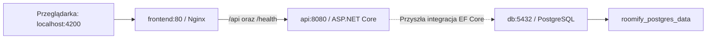

# Kontenery Roomify — WP-01.4

## Status i przeznaczenie

Przygotowano konfigurację trzech usług: `frontend`, `api` i `db`. Jest przeznaczona do lokalnego developmentu oraz demonstracji akademickiej, bez domeny publicznej i TLS. Nie obejmuje EF Core, Identity, migracji ani logiki biznesowej.

W środowisku wykonania WP-01.4 nie znaleziono instalacji Docker ani silnika kontenerów. Pobraną lokalnie samodzielną wersję Compose wykorzystuje się do walidacji konfiguracji, ale nie zastępuje ona silnika Docker. Uruchomienie całego środowiska i kontrole kontenerowe pozostają niepotwierdzone do czasu rzeczywistego wykonania na hoście z Dockerem. Nie oznaczamy samego przygotowania plików jako ukończenia uruchomienia WP-01.4.

## Podstawowe pojęcia

- **Docker** to zestaw narzędzi do budowania i uruchamiania aplikacji w izolowanych środowiskach korzystających z jądra hosta. Docker Desktop na Windows zapewnia środowisko do uruchamiania kontenerów Linux, np. przez WSL 2.
- **Obraz** jest warstwowym pakietem plików, zależności i metadanych uruchomienia. Nie jest działającym procesem ani miejscem przechowywania sekretów.
- **Kontener** to uruchomiona instancja obrazu. Jego warstwa zapisu jest tymczasowa z punktu widzenia odtwarzania środowiska.
- **Dockerfile** opisuje tworzenie obrazu: wybór bazy, kopiowanie, kompilację i sposób uruchamiania.
- **Docker Compose** opisuje kilka usług, ich konfigurację, zależności, sieci i wolumeny w jednym pliku YAML.
- **Multi-stage build** rozdziela kompilację od uruchamiania. Końcowy obraz API nie zawiera SDK, a obraz frontendu nie zawiera Node.js ani źródeł Angulara.

## Obrazy i konteksty budowania

| Przeznaczenie | Obraz |
|---|---|
| Kompilacja .NET | `mcr.microsoft.com/dotnet/sdk:10.0.301-noble` |
| Uruchomienie API | `mcr.microsoft.com/dotnet/aspnet:10.0.9-noble` |
| Kompilacja Angulara | `node:24.19.0-bookworm-slim` |
| Serwowanie Angulara | `nginx:1.30.6-alpine` |
| Baza danych | `postgres:18.6-bookworm` |

Dostępność konkretnych tagów sprawdzono w oficjalnych rejestrach. Tagi nie są `latest`, ale mogą otrzymywać aktualizacje warstw systemowych; pełne zamrożenie zawartości wymagałoby przypięcia digestów. Aktualizacje obrazów należy wykonywać świadomie i ponownie weryfikować środowisko.

Kontekst API to `backend/`. Dockerfile kopiuje najpierw cztery produkcyjne `.csproj`, wykonuje restore projektu API z jego zależnościami, następnie kopiuje źródła, buduje Release i publikuje API. Nie buduje całego rozwiązania, które od WP-01.5 zawiera też wykluczone z kontekstu projekty testowe. Zmiana samego kodu nie unieważnia wcześniejszej warstwy restore. Finalny obraz działa jako wbudowany użytkownik `app` wskazany przez `APP_UID`, na porcie 8080. Nie instaluje dodatkowych narzędzi systemowych.

Kontekst frontendu to `frontend/`. Najpierw kopiowane są `package.json` i `package-lock.json`, a `npm ci` odtwarza zależności. Następnie powstaje build produkcyjny. Zweryfikowana lokalizacja dokumentu startowego to `dist/roomify/browser/index.html`; zawartość tego katalogu trafia do `/usr/share/nginx/html/` w Nginx. Konfiguracja `infra/nginx/default.conf` jest montowana tylko do odczytu przez Compose, dlatego sam obraz frontendu poza Compose wymaga dostarczenia tej konfiguracji.

Oba konteksty mają `.dockerignore`, wykluczające lokalne zależności, wyniki kompilacji i konfigurację z sekretami. Główny `.env` znajduje się poza oboma kontekstami, więc nie trafia do obrazów.

## Sieć i komunikacja



Usługi należą do sieci bridge `${COMPOSE_PROJECT_NAME}_network`. DNS Compose pozwala używać nazw `api` i `db`; `localhost` wewnątrz kontenera wskazuje ten kontener, a nie host ani sąsiednią usługę. Nie używamy `network_mode: host` ani trybu privileged.

| Usługa | Adres w sieci Compose | Domyślny adres hosta |
|---|---|---|
| frontend | `frontend:80` | `127.0.0.1:4200` |
| api | `api:8080` | `127.0.0.1:5080` — diagnostyka |
| db | `db:5432` | `127.0.0.1:5432` — lokalne narzędzia bazy |

Porty hosta można zmieniać przez `FRONTEND_PORT`, `API_PORT` i `POSTGRES_HOST_PORT`, bez zmiany portów wewnętrznych. Zmienna `API_PORT` zastępuje wcześniejsze `BACKEND_PORT`, a `POSTGRES_HOST_PORT` zastępuje wcześniejsze `POSTGRES_PORT`, aby jednoznacznie odróżnić host od kontenera. Profile `dotnet run` nie odczytują `.env` i nadal używają swoich ustawień.

Przeglądarka używa jednego originu. Nginx kieruje dokładne `/api` oraz prefiks `/api/` do `api:8080`. `proxy_pass` nie zawiera końcowego ukośnika ani ścieżki, więc zachowuje prefiks i parametry zapytania. `/health` trafia do backendowego `/health`. Nagłówki Host i X-Forwarded-* przekazują kontekst pierwotnego żądania. API nie konfiguruje jeszcze zaufania do forwarded headers; należy je ograniczyć do kontrolowanego proxy w odpowiednim etapie.

Pozostałe ścieżki używają `try_files` z fallbackiem do `index.html`, co pozwala odświeżyć `/home` i inne trasy CSR. Osobne lokalizacje proxy nie korzystają z fallbacku Angulara: nieistniejący endpoint `/api` ma zachować odpowiedź backendu, np. 404, a niedostępne API może dać 502. Dokument startowy ma nagłówki wyłączające cache. Nie dodano CORS ani uwierzytelniania w Nginx. Przyszłe cookies i operacje zmieniające stan wymagają ochrony CSRF.

## PostgreSQL i konfiguracja API

Oficjalny PostgreSQL 18 używa `PGDATA=/var/lib/postgresql/18/docker`, a nazwany wolumen montujemy pod `/var/lib/postgresql`, zgodnie z [dokumentacją oficjalnego obrazu](https://github.com/docker-library/docs/blob/master/postgres/README.md). Nie stosujemy starszego montowania pod `/var/lib/postgresql/data`. Brak skryptów inicjalizujących encje i brak migracji. Obraz utworzy standardową bazę oraz rolę inicjalizacyjną z `POSTGRES_DB`, `POSTGRES_USER` i `POSTGRES_PASSWORD` przy pierwszym uruchomieniu pustego wolumenu.

Rola wskazana przez `POSTGRES_USER` ma uprawnienia inicjalizacyjnego superużytkownika. Jest to lokalna konfiguracja demonstracyjna; przed produkcyjną integracją należy wydzielić konto o minimalnych uprawnieniach. Nie ustawiamy `POSTGRES_HOST_AUTH_METHOD=trust`.

API otrzymuje sekcję konfiguracji jako `Database__Host`, `Database__Port`, `Database__Name`, `Database__Username` i `Database__Password`. .NET odwzorowuje podwójne podkreślenia na zagnieżdżenie sekcji. Od WP-02.2 Infrastructure składa je przez NpgsqlConnectionStringBuilder i rejestruje DbContext z UseNpgsql, bez otwierania połączenia przy starcie. Alternatywne ConnectionStrings__Roomify ma pierwszeństwo. [PERSISTENCE.md](PERSISTENCE.md) opisuje konfigurację i testy. Nie ma migracji ani tworzenia tabel; /health nie sprawdza bazy.

## Healthchecki i kolejność startu

- Baza: `pg_isready` przez TCP z nazwą użytkownika i bazy ze środowiska kontenera. `$$` chroni zmienne przed wcześniejszą interpolacją przez Compose. Jest to kontrola gotowości serwera, nie test poprawności hasła ani schematu.
- API: `/bin/bash /app/healthcheck.sh` wykorzystuje `/dev/tcp` w Bashu obrazu Noble. Wysyła HTTP do lokalnego portu 8080 i wymaga statusu 200 oraz linii `Healthy`. Obsługuje także odpowiedź chunked. Timeout Compose ogranicza oczekiwanie. Nie instalujemy curl/wget i nie dodajemy osobnego programu .NET do kontroli.
- Frontend: zależy od zdrowego API. Odpowiedzi Nginx sprawdza się z hosta; nie dodano mu dodatkowego healthchecka.

Obie kontrole mają interval, timeout, retries i start_period. API ma `depends_on: db: condition: service_healthy`, a frontend analogicznie zależy od API. Jest to oczekiwanie na zdrowie przy starcie; nie gwarantuje ciągłej dostępności i nie powoduje automatycznego restartu usług po późniejszej awarii zależności. API pozostaje logicznie niezależne od bazy, choć uruchamianie całego zestawu oczekuje na nią jako przygotowanie przyszłej integracji.

## Wymagania i uruchamianie

Na Windows zainstaluj [Docker Desktop](https://docs.docker.com/desktop/setup/install/windows-install/), spełnij wymagania WSL 2/wirtualizacji i uruchom silnik w trybie kontenerów Linux. Desktop dostarcza Docker CLI i Compose. Na Linux użyj [Docker Engine](https://docs.docker.com/engine/install/) oraz [wtyczki Compose](https://docs.docker.com/compose/install/linux/). Nie potrzeba lokalnego .NET SDK ani Node do budowania obrazów, ale potrzebny jest dostęp do rejestrów obrazów, NuGet i npm.

W katalogu głównym repozytorium:

```powershell
docker version
docker compose version
if (-not (Test-Path .env)) { Copy-Item .env.example .env }
```

W lokalnym, ignorowanym `.env` ustaw własne hasło developerskie. Nie wyświetlaj go w logach ani nie wersjonuj pliku. Compose odczytuje `.env` automatycznie; wymagane nazwa bazy, użytkownik i hasło nie mogą być puste. Zmienne środowiska powłoki mogą nadpisać wartości `.env`.

```powershell
docker compose config --quiet
docker compose build
docker compose up -d
docker compose ps
```

`docker compose config` bez `--quiet` wypisuje rozwiniętą konfigurację, w tym hasło. Nie wklejaj takiego wyniku do raportów. Przejdź do [frontendu](http://localhost:4200/home) i [healthchecka przez Nginx](http://localhost:4200/health). Przy zmianie `FRONTEND_PORT` dostosuj adres.

```powershell
Invoke-WebRequest http://localhost:4200/
Invoke-WebRequest http://localhost:4200/home
Invoke-WebRequest http://localhost:4200/health
docker compose exec db sh -c 'pg_isready -h 127.0.0.1 -U "$POSTGRES_USER" -d "$POSTGRES_DB"'
docker compose exec api /bin/bash /app/healthcheck.sh
docker compose exec frontend nginx -t
```

Healthcheck powinien zwrócić 200 i `Healthy`. Dla `/api` lub `/api/nieistniejacy-endpoint` oczekiwana jest odpowiedź 404 z API, bez HTML Angulara. Te kontrole trzeba wykonać na uruchomionym Dockerze; same pliki nie dowodzą ich powodzenia.

## Logi, przebudowa i problemy

```powershell
docker compose logs --tail=100
docker compose logs -f api
docker compose build
docker compose up -d
docker compose restart api
```

Przy braku silnika sprawdź Docker Desktop i `docker version`. Zajęty port rozwiąż przez zmianę odpowiedniego portu hosta w `.env` albo zatrzymanie własnego procesu developerskiego. Jeśli baza jest unhealthy, sprawdź jej logi i healthcheck; nie kasuj wolumenu. Błąd 502 z Nginx wskazuje m.in. niedostępność API lub niewłaściwą sieć. Błędy pobierania obrazów i zależności wymagają sprawdzenia dostępu do rejestrów oraz proxy sieciowego.

Zmiana hasła w `.env` nie zmienia hasła istniejącej roli PostgreSQL. Zmienne inicjalizacji obrazu działają tylko dla pustego katalogu danych. Nie naprawiaj tego przez usuwanie wolumenu; uzgodnij zmianę hasła w istniejącej bazie. Jawnie przypięta nazwa `roomify_postgres_data` jest wspólna także po zmianie nazwy projektu Compose, więc zmiana `COMPOSE_PROJECT_NAME` nie tworzy niezależnego zestawu danych.

## Zatrzymanie i trwałość danych

```powershell
docker compose stop
docker compose start
docker compose down
docker volume inspect roomify_postgres_data
```

Wolumen jest trwałym zasobem oddzielonym od kontenerów. `stop` zatrzymuje procesy; zwykłe `down` usuwa kontenery i sieć projektu, ale zachowuje nazwany wolumen. Kolejne `up -d` ponownie go dołącza. Nie używaj `down -v`, automatycznego czyszczenia ani usuwania wolumenów bez świadomej decyzji i zgody właściciela danych. Przed zmianą głównej wersji PostgreSQL potrzebny jest plan migracji i kopia zapasowa; samo pozostawienie wolumenu nie jest kopią zapasową.

Żadne polecenie przygotowania WP-01.4 nie usuwa danych. Sekrety są przekazywane do kontenerów w czasie uruchomienia, więc nie trafiają do obrazu, ale użytkownik mający dostęp do Dockera może odczytać ich konfigurację. Ten model lokalny nie zastępuje produkcyjnego zarządzania sekretami, TLS i kontroli dostępu.
