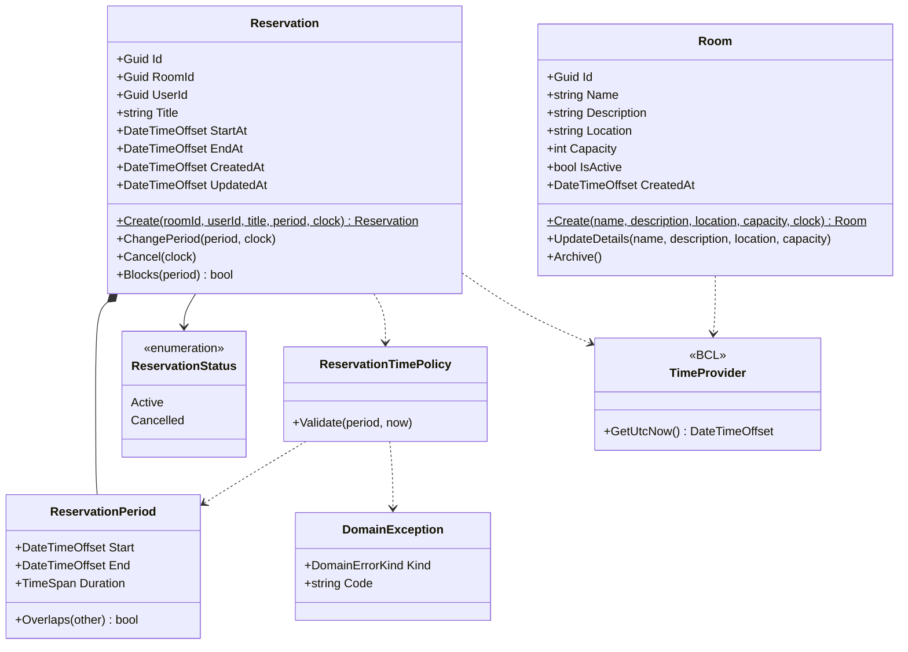

# Model domenowy Roomify — WP-02.1

## Zakres i odpowiedzialności

`Roomify.Domain` zawiera encje `Room` i `Reservation`, obiekt wartości `ReservationPeriod`, `ReservationStatus`, politykę `ReservationTimePolicy` i błędy domenowe. Projekt pozostaje `net10.0`, bez pakietów i referencji do innych projektów, EF Core, ASP.NET Core, Identity, PostgreSQL lub HTTP. Identyfikatory sal i użytkowników są typu Guid. API i Application nie są jeszcze podłączone do modelu.



Strzałki opisują zależności typów. Powiązanie Reservation z salą/użytkownikiem to identyfikatory, bez nawigacji i bez obiektów Identity. Nullable w kodzie: Room.Description oraz Reservation.UpdatedAt. Diagram upraszcza te oznaczenia.

## Encje i hermetyzacja

Room ma prywatny konstruktor i fabrykę tworzącą aktywną salę z nowym Id. Nazwa i lokalizacja są wymagane, po trimowaniu mają odpowiednio 1–100 i 1–150 znaków; pojemność jest dodatnia. Opis jest opcjonalny; pusty/biały opis normalizujemy do null. Nie nakładamy nieudokumentowanej maksymalnej długości opisu. Aktualizacja waliduje wszystkie dane przed zmianą stanu, zachowuje Id i CreatedAt. Archive jest idempotentne, zmienia wyłącznie IsActive. Brak publicznych setterów.

WP-00 nie przewiduje reaktywacji ani zakazu poprawiania opisu zarchiwizowanej sali; dlatego nie ma Activate, a UpdateDetails jest dostępne także po archiwizacji i nie przywraca aktywności. To rozstrzygnięcie minimalnego zakresu, nie nowa reguła ograniczająca użytkownika. Unikalność nazwy oraz zakaz nowej rezerwacji sali nieaktywnej muszą być sprawdzane przez Application/bazę — encja Room nie zna zbioru sal, a Reservation otrzymuje tylko RoomId. Wyposażenie z pełnego FR-ROOM-002 nie należy do modelu zleconego w WP-02.1 i nie jest deklarowane jako zaimplementowane.

Reservation wymaga niepustych RoomId/UserId, tytułu 1–120 znaków po trimowaniu i poprawnego terminu. Id, RoomId, UserId, Title i CreatedAt są niezmienne. Termin i status mają prywatne settery. W WP-02.2 czas reprezentuje jedna para prywatnych pól _startAt/_endAt w UTC; StartAt/EndAt je odczytują, a Period zwraca niemutowalną migawkę z walidacją BR-001. Fabryka tworzy Active i UpdatedAt=null. ChangePeriod ponownie waliduje politykę i ustawia oba końce oraz UpdatedAt, nie zmienia właściciela ani sali. Nie dodano edycji tytułu/sali poza zlecony zakres.

Statusy pochodzą wprost z WP-00/TEST_STRATEGY: `Active → Cancelled`, bez ponownego otwierania. Zmiana terminu i pierwsze anulowanie wymagają aktywnej, nierozpoczętej rezerwacji (BR-017). Ponowne Cancel jest idempotentne również po pierwotnym terminie: zachowuje status i UpdatedAt (BR-027). Anulowanie nie usuwa danych (BR-018). Blocks zwraca false dla Cancelled (BR-009); dla Active deleguje sprawdzenie geometrii do Period. Wybranie rezerwacji właściwej sali należy do Application. Nie jest to zabezpieczenie współbieżności ani mechanizm zapisu.

## Obiekt wartości i przedziały półotwarte

`ReservationPeriod` jest sealed record z właściwościami tylko do odczytu. Nie ma tożsamości encji — równość dotyczy znormalizowanych końców przedziału. Konstruktor wymaga End > Start i przelicza oba DateTimeOffset do UTC. Różne offsety opisujące te same chwile dają równe wartości. Brak setterów/init uniemożliwia zmianę końców przez `with`; kopia zachowuje poprawność.

`Duration = End - Start` oznacza rzeczywisty czas, niezależny od offsetu. Overlaps stosuje dokładnie `Start < other.End && End > other.Start`. Przedział `[Start, End)` zawiera początek, ale wyłącza koniec. Przedziały stykające się nie kolidują. Sam obiekt wartości może przekraczać północ lub mieć dokładność ticka — poprawność geometryczna nie oznacza dopuszczalnej rezerwacji. Reguły godzin, daty, minut i limitu długości należą do osobnej polityki.

## Zegar i reguły czasu

W Create/ChangePeriod/Cancel przekazywany jest `TimeProvider`. Operacja odczytuje zegar raz; ten sam moment służy walidacji i metadanym. Model nie korzysta z DateTime.Now, strefy lokalnej hosta ani globalnego testowego zegara. Testy używają własnych instancji ControlledTimeProvider. W produkcyjnym składaniu zależności będzie można przekazać TimeProvider.System; obecnie nie dodano integracji DI.

`ReservationTimePolicy` otrzymuje jawne `now`, bez samodzielnego odczytu czasu. Oddziela reguły biznesowe od geometrii Period. Godziny i limit są stałymi zasadami Roomify: 08:00–20:00 oraz najwyżej 8 godzin. Nie dodano możliwości konfigurowania innych godzin, która pozwalałaby ominąć zatwierdzony zakres. Polityka sprawdza kolejno:

1. Start jest **ściśle późniejszy** od now. WP-02.1 mówi o zakazie przeszłości, a BR-002 precyzuje „późniejszy”; równość odrzucamy według dokładniejszego WP-00.
2. Duration ≤ 8 godzin.
3. Oba końce mają dokładność pełnej minuty; sekundy i ułamki sekundy odrzucamy (BR-015, bez cichej normalizacji).
4. Po przeliczeniu do Europe/Warsaw oba końce należą do tego samego dnia (BR-014).
5. Początek nie jest wcześniejszy niż 08:00, a koniec późniejszy niż 20:00. Z End > Start i tego samego dnia wynika start < 20:00 i end > 08:00 (BR-016).

TimeZoneInfo używa jawnego identyfikatora `Europe/Warsaw`. Strefa wymaga dostępnych danych stref czasowych hosta; brak danych ma być widoczną usterką środowiska, bez fallbacku na lokalną strefę lub stały offset. API tego etapu przyjmuje DateTimeOffset opisujące jednoznaczne chwile. Rozstrzyganie nieistniejących/niejednoznacznych lokalnych godzin formularza należy do przyszłego kontraktu wejściowego, nie do zgadywania w Domain.

O 08:00 w Warszawie jest 07:00Z zimą i 06:00Z latem. Jawne przypadki testowe obejmują 28/29 marca oraz 24/25 października 2026; sprawdzają również minutę przed otwarciem i po zamknięciu. Godziny dostępności nie przecinają nocnego przejścia DST.

## Błędy domenowe

DomainException ma Kind: InvalidInput (pola/identyfikatory), InvalidState (zmiana statusu lub rozpoczętej rezerwacji), InvalidPeriod (geometria i polityka czasu). Code identyfikuje BR lub pole, np. BR-001, BR-007, room.capacity. Polskie komunikaty objaśniają naruszenie; testy sprawdzają stabilne kody i kategorie, bez wiązania kontraktu z tekstem komunikatu. Brak kodów HTTP. Mapowanie na odpowiedzi API nastąpi później.

ArgumentNullException sygnalizuje błąd użycia API programistycznego (brak TimeProvider/Period), odrębny od niepoprawnych danych użytkownika. W WP-02.2 dodano wyłącznie prywatny konstruktor skalarny Reservation dla standardowej materializacji EF. Zachowuje walidację identyfikatorów/tytułu i poprawność geometrii Period; nie wymaga przyszłości od danych historycznych. Publiczne tworzenie/zmiana nadal egzekwują pełną politykę czasu. Domain nie zawiera zależności ORM ani atrybutów; szczegóły i powód odrzucenia ComplexProperty opisuje [PERSISTENCE.md](PERSISTENCE.md).

## Przykłady graniczne i powiązania z WP-00

| Przypadek (czas lokalny Warszawy) | Wynik | Reguła / test |
|---|---|---|
| 10–11 i 11–12 | Brak nakładania | BR-004, ReservationPeriodTests.Overlaps_UsesHalfOpenIntervalsSymmetrically |
| 10–12 i 11:59–13; zawieranie; identyczne | Nakładanie | BR-003, ta sama Theory; sam algorytm, bez bazy |
| Start = End lub End < Start | InvalidPeriod | BR-001, Constructor_RejectsEqualOrEarlierEnd |
| 08–16 oraz 12–20 | Dozwolone, 8 godzin | BR-007/008/016, Booking_AcceptsOpeningClosingAndEightHourBoundaries |
| 08–16:01 | Odrzucenie | BR-007, Booking_RejectsInvalidBusinessPeriod |
| 07:59–09 lub 19–20:01 | Odrzucenie | BR-008/016, ta sama Theory i testy DST |
| Start równy now lub wcześniejszy | Odrzucenie | BR-002, Booking_UsesInjectedClockAndRequiresStrictlyFutureStart |
| Przedział przez lokalną północ | Odrzucenie w polityce | BR-014, Policy_RejectsMultiDayPeriodEvenWhenUtcDatesDifferFromWarsaw |
| Sekunda lub pojedynczy dodatkowy tick | Odrzucenie w polityce | BR-015, Booking_RejectsInvalidBusinessPeriod |
| Zmiana terminu powtarza walidację, nie zmienia właściciela | Dozwolona wyłącznie przed startem | BR-012/017/023, ChangePeriod_* oraz ChangeAndCancel_* |
| Cancelled nie blokuje terminu, ponowny Cancel zachowuje metadane | Dozwolone | BR-009/018/027, Cancel_* |
| Brak/za długi tytuł | InvalidInput | BR-024, Create_RejectsMissingTitle i testy granic długości |
| Brak nazwy/lokalizacji, pojemność ≤ 0, za długie pola | InvalidInput | BR-025 (bez unikalności), RoomTests |
| Archiwizacja zachowuje dane i status nieaktywny po edycji | Dozwolone | Część BR-019, Archive_IsIdempotentAndKeepsDataEditableWithoutReactivation |

Wymagania `[Z]`/`[P]` zachowują pierwotne oznaczenia w WP-00. Ten etap realizuje wskazany przez użytkownika podzbiór modelu i doprecyzowań; nie zatwierdza innych propozycji. BR-005/011/021/022/028 (uprawnienia/konta), BR-006/013 (istnienie/aktywność innych obiektów), BR-010/026 (baza i współbieżność), unikalność z BR-025 i wykluczanie własnego ID w kolekcji przy BR-012 pozostają poza implementacją. Brak pełnej realizacji FR-ROOM/FR-RES przez API.

## Pliki i testowanie

Kod: Rooms/Room.cs; Reservations/Reservation.cs, ReservationPeriod.cs, ReservationTimePolicy.cs, ReservationStatus.cs; Errors/DomainException.cs, DomainErrorKind.cs i wewnętrzny DomainGuard.cs. Testy: RoomTests.cs, ReservationTests.cs, ReservationPeriodTests.cs, ReservationTimePolicyTests.cs oraz pomocniczy DomainTestData.cs. Nie zmieniono referencji i zależności pakietowych.

Z katalogu głównego:

```powershell
dotnet restore backend/Roomify.slnx
dotnet build backend/Roomify.slnx --configuration Debug --no-restore
dotnet build backend/Roomify.slnx --configuration Release --no-restore
dotnet test backend/tests/Roomify.Domain.UnitTests --no-restore --collect:"XPlat Code Coverage" --results-directory artifacts/wp021/trx
dotnet test backend/tests/Roomify.Application.UnitTests --no-restore
dotnet test backend/tests/Roomify.Api.IntegrationTests --no-restore --filter "RequiresDocker=false"
```

Mutacje, z `backend/tests/Roomify.Domain.UnitTests`:

```powershell
dotnet stryker --config-file stryker-config.json --output ../../../artifacts/wp021/mutation --skip-version-check --concurrency 4
```

Nie są potrzebne Docker, baza ani zegar systemowy do testów Domain. [UNIT_TESTS.md](../testing/UNIT_TESTS.md) oraz [MUTATION_TESTS.md](../testing/MUTATION_TESTS.md) opisują narzędzia. Wyniki WP-02.1 i macierz AC-001–AC-025 zachowano w [WP02_1_REPORT.md](../testing/WP02_1_REPORT.md). WP-02.2 dodaje mapowanie i dwa testy domenowe, łącznie **87/87**; [raport WP02_2_REPORT.md](../testing/WP02_2_REPORT.md) opisuje materializację, change tracking i ich granice. WP-02.3 dodał [Identity](IDENTITY.md) i FK użytkownika wyłącznie po stronie Infrastructure; źródła Domain nie zmieniły się. Był to stan przed WP-02.4; aktualizację odbioru opisano poniżej.

## Aktualny odbiór WP-02.5 — 18.10.2026

Opis WP-02.1/02.2 powyżej zachowuje historię; WP-02.4 wdrożył już [schemat i exclusion PostgreSQL](DATABASE.md). W WP-02.5 produkcyjne źródła domeny bez zmian. **110/110 testów Domain**, coverage 160/160 linii i 38/38 gałęzi, Stryker **93,46%** (100 Killed, 7 Survived, pozostałe kategorie jawnie w raporcie). Dodano kontrakty null/komunikatów i samodzielnej polityki na obu datach DST. [Odbiór WP-02](../testing/WP02_ACCEPTANCE_REPORT.md) i [macierz FR/BR](../testing/REQUIREMENTS_TRACEABILITY.md) rozróżniają obecne reguły od przyszłych uprawnień/aktywności/API. WP-03 nie rozpoczęto.

## Rozszerzenie edycji — WP-03.2

Reservation ma prywatny setter Title oraz ValidateUpdate/UpdateDetails. Wspólna walidacja wykorzystuje DomainGuard, EnsureCanChange i ReservationTimePolicy. ValidateUpdate nie zmienia stanu; UpdateDetails najpierw waliduje komplet danych, potem atomowo przypisuje tytuł/okres/UpdatedAt. Id/RoomId/UserId/CreatedAt pozostają niezmienne. Istniejące ChangePeriod/Cancel bez zmiany semantyki, brak przywracania Cancelled. Domain nie zna wersji xmin, EF ani ról HTTP. 116/116 testów Domain, 6 nowych; coverage/mutacji Domain nie przeliczano dla rozszerzenia. [Zarządzanie rezerwacjami](RESERVATION_MANAGEMENT.md), [raport](../testing/WP03_2_REPORT.md).

## Rozszerzenie WP-03.3

Room.Activate() przywraca IsActive bez zmiany tożsamości/danych. Room.ValidateUpdate() korzysta z tej samej walidacji co Create/UpdateDetails, bez mutacji. Pozostałe niezmienniki bez zmian. [Zarządzanie salami](ROOM_MANAGEMENT.md) opisuje uprawnienia, zachowanie historii i testy.
