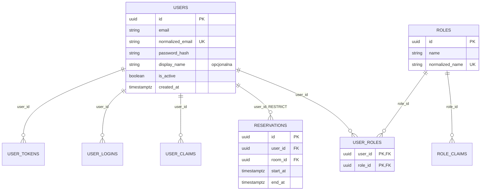

# Identity i cookies — WP-02.3

> Aktualizacja WP-03.4: poniższy opis zachowuje zakres poprzedniego etapu. Wspólny ApplicationAccess sprawdza teraz IsActive, a produkcyjny adapter Identity i walidacja cookies co żądanie są zaimplementowane. [Zarządzanie kontami](USER_MANAGEMENT.md), [bieżący raport](../testing/WP03_4_REPORT.md). Produkcyjne endpointy logowania/biznesowe nadal nie istnieją.


> Aktualizacja 18.10.2026: poniżej zachowano opis i wyniki WP-02.3. **WP-02.4 zakończono**: wspólna migracja wdrożyła również siedem tabel Identity. Schemat, round-trip i FK sprawdzono na PostgreSQL; baza developerska nadal bez kont. [DATABASE.md](DATABASE.md), [raport WP-02.4](../testing/WP02_4_REPORT.md).

## Zakres i architektura

ASP.NET Core Identity dostarcza standardowe zarządzanie kontami, rolami, hasłami, blokadą i znacznikami bezpieczeństwa. W Roomify korzysta z jednego RoomifyDbContext oraz providera PostgreSQL. W tym pakiecie przygotowano model, DI i potok cookies; **nie istnieją jeszcze login, logout, /api/auth/me, rejestracja, seed ani tabele**. Gotowość infrastruktury nie oznacza możliwości logowania przez API.

ApplicationUser należy do Infrastructure i dziedziczy po IdentityUser<Guid>. Guid odpowiada istniejącemu Reservation.UserId; Domain nie otrzymuje zależności ani nawigacji do Identity. Role mają standardowy typ IdentityRole<Guid>. Nazwy User i Administrator są centralnie zdefiniowane w IdentityRoles, do przyszłych wywołań RoleManager i kontrolowanego seedowania. Obecny kod nie zapisuje ani nie nadaje ról.



Diagram przedstawia model docelowego zapisu, nie istniejące tabele. Każda rezerwacja ma dokładnie jednego użytkownika, użytkownik może mieć wiele rezerwacji. Restrict uniemożliwi kaskadowe usunięcie ich historii po wdrożeniu FK. Standardowe zależności techniczne Identity zachowują własne klucze i relacje. Reguły właściciela oraz uprawnienia administratora w przypadkach użycia nie są jeszcze zaimplementowane.

## Model użytkownika i decyzje WP-00

WP-00 opisuje DisplayName, IsActive i CreatedAt. Dodano opcjonalną nazwę wyświetlaną bez arbitralnego limitu długości, IsActive=true oraz CreatedAt w UTC. Nie dodano FirstName/LastName — występowały wyłącznie jako propozycje w zleceniu i nie są wymaganiami Roomify. Nie dodano dodatkowego pola hasła ani własnego PasswordHash.

Domyślny konstruktor nadaje nowy Guid i odczytuje TimeProvider.System; przeciążenie z TimeProvider pozwala deterministycznie ustawić czas w testach i przyszłym procesie administracyjnego tworzenia. CreatedAt ma prywatny setter dla standardowej materializacji. Publiczne właściwości Identity służą managerom/stores, a nie wiązaniu niezaufanego DTO bezpośrednio do encji. Przyszłe endpointy muszą jawnie ograniczyć dane, aby użytkownik nie nadawał sobie IsActive/roli/uprawnień.

Email i NormalizedEmail są wymagane w modelu ze względu na FR-AUTH-001/004. RequireUniqueEmail i istniejący indeks NormalizedEmail z IsUnique realizują przygotowanie BR-020: normalizację wykonuje standardowy UserManager/ILookupNormalizer. Nie dodano drugiego indeksu email ani ręcznej normalizacji. NormalizedUserName zachowuje własny unikalny indeks i limit 256. Oznaczeń WP-00 `[Z]`/`[P]` nie zmieniono.

**IsActive jest obecnie polem modelu, nie gotowym mechanizmem blokowania sesji.** Przed implementacją logowania należy sprawdzać aktywność przy logowaniu, a dezaktywację powiązać z unieważnianiem SecurityStamp i walidacją sesji. Nie deklarujemy ukończenia FR-AUTH-005/BR-021 tylko na podstawie obecności pola.

## Jeden DbContext i mapowania

RoomifyDbContext dziedziczy po IdentityDbContext<ApplicationUser, IdentityRole<Guid>, Guid>. OnModelCreating wywołuje najpierw base, następnie istniejące konfiguracje biznesowe i jawne IdentityModelConfiguration. Rooms/Reservations i cały model Identity mają te same DbContextOptions, połączenie i zakres DI. Nie ma drugiego kontekstu/bazy użytkowników.

| Typ | Tabela w modelu | Klucz |
|---|---|---|
| ApplicationUser | users | Id: Guid |
| IdentityRole<Guid> | roles | Id: Guid |
| IdentityUserRole<Guid> | user_roles | UserId + RoleId |
| IdentityUserClaim<Guid> | user_claims | Id: int |
| IdentityUserLogin<Guid> | user_logins | LoginProvider + ProviderKey |
| IdentityUserToken<Guid> | user_tokens | UserId + LoginProvider + Name |
| IdentityRoleClaim<Guid> | role_claims | Id: int |

Kolumny Identity mają snake_case; zachowano złożone klucze, indeksy nazw, PasswordHash, SecurityStamp, ConcurrencyStamp jako concurrency token, LockoutEnd/Enabled i AccessFailedCount. CreatedAt i LockoutEnd używają timestamptz. Zależność Reservation.UserId → users.id ma DeleteBehavior.Restrict i nie wprowadza nawigacji do Domain. Nazwy/kolumny/indeksy Room i Reservation oraz mapowanie pól Period pozostają zgodne z WP-02.2.

IdentityOptions.Stores.SchemaVersion=Version2 oraz MaxLengthForKeys=128 utrzymują standardowy model haseł/ról bez passkeys, których nie zlecono. To wersja modelu stores Identity, nie zmiana wersji EF. .NET 10 w Version3 dodaje passkeys; zakresy opisuje [kod Microsoft dla 10.0.9](https://github.com/dotnet/aspnetcore/blob/v10.0.9/src/Identity/EntityFrameworkCore/src/IdentityUserContext.cs). Jawne długości kluczy loginów/tokenów i numeru telefonu utrzymują ten sam model również w testach kontekstu konstruowanego poza DI. Nie usunięto żadnego z siedmiu wymaganych typów Identity.

## Managerowie, stores i hasła

AddInfrastructure(configuration, environment) rejestruje DbContext raz, następnie AddIdentity<ApplicationUser, IdentityRole<Guid>> i AddEntityFrameworkStores<RoomifyDbContext>. UserManager koordynuje walidację konta, normalizację, hasła i przypisanie ról. RoleManager zarządza rolami. SignInManager obsługuje przyszłe logowanie/wylogowanie i współpracę z cookies. UserStore i RoleStore korzystają z tego samego Scoped RoomifyDbContext; test sprawdza tożsamość ich Context.

Hasła obsługuje wbudowany PasswordHasher i standardowe walidatory Identity; przechowywany będzie tylko solony hash w standardowym PasswordHash. Nie piszemy własnej kryptografii ani nie logujemy haseł. Nie tworzymy rzeczywistych kont podczas obecnych testów.

Proponowana i skonfigurowana polityka techniczna:

- minimum 12 znaków, co najmniej mała i wielka litera oraz cyfra;
- znaki specjalne dozwolone, lecz niewymagane;
- Lockout dla nowych kont, 5 nieudanych prób, blokada 15 minut;
- email unikalny; bez wymogu potwierdzania go pocztą, której nie ma w zakresie.

Nie dodano własnego algorytmu oceny siły hasła. Przy przyszłym PasswordSignInAsync należy włączyć lockoutOnFailure i testować faktyczne naliczanie prób — same opcje nie są gotowym endpointem blokady.

## Uwierzytelnianie i autoryzacja

Uwierzytelnianie ustala tożsamość na podstawie chronionego biletu cookies. Autoryzacja sprawdza, czy ta tożsamość może wykonać operację, np. na podstawie roli. Program rejestruje standardowe usługi autoryzacji i uruchamia UseRouting → UseAuthentication → UseAuthorization. Nie ma globalnej polityki wymagającej logowania ani ochrony /health. Nie dodano polityk właściciela rezerwacji.

AddIdentity rejestruje aplikacyjny schemat Identity.Application oraz standardowe pomocnicze cookies Identity; **nie oznacza to dołączenia OAuth lub zewnętrznych providerów**. Nie ma JWT ani Identity UI. Framework umożliwia przyszłe wylogowanie przez SignInManager.SignOutAsync, lecz endpoint logout nie istnieje.

| Ustawienie aplikacyjnego cookie | Wartość |
|---|---|
| Nazwa / Path / Domain | Roomify.Auth / `/` / brak Domain, czyli host-only |
| HttpOnly | true |
| SameSite | Lax, jeden origin Angular/API |
| SecurePolicy | Always poza Development; SameAsRequest w Development dla lokalnego HTTP, a HTTPS nadal daje Secure |
| Żywotność biletu | 30 minut, bez SlidingExpiration |
| SecurityStamp validation interval | 5 minut |
| Challenge / odmowa dostępu | 401 / 403, bez Location i przekierowania do Razor |

Bez environment rejestracja wybiera bezpieczne SecurePolicy.Always. Standardowy security stamp validator zachowano. Nie należy interpretować pięciominutowej kontroli jako natychmiastowego odwołania wszystkich sesji ani kontroli IsActive.

ASP.NET Core 10 domyślnie [zwraca 401/403 dla rozpoznanych endpointów API](https://learn.microsoft.com/en-us/aspnet/core/breaking-changes/10/cookie-authentication-api-endpoints?view=aspnetcore-10.0). W Roomify ustawiono dodatkowo jawne zdarzenia przekierowań, bo cały backend jest API; zachowanie nie zależy od przypisania metadanych endpointu. Potwierdzono je rzeczywistymi żądaniami w TestServer, także z biletem roli User.

Cookies są chronione przez standardowe Data Protection. Przed udostępnieniem logowania w kontenerach potrzebna będzie trwała, chroniona konfiguracja key ring, właściwe uprawnienia i TLS. Obecny pakiet nie dodaje wolumenu kluczy. Testowa fixture używa wyłącznie kluczy efemerycznych, bez zapisywania ich do repozytorium.

## CSRF i brak rejestracji

SameSite i HttpOnly nie zastępują ochrony CSRF. Przed dodaniem zmieniających stan POST/PUT/PATCH/DELETE, w tym login/logout, trzeba skonfigurować antiforgery, bezpieczne wydanie tokenu Angularowi i walidację tokenu po stronie serwera. Docelowy nagłówek powinien być spójny z Angular X-XSRF-TOKEN; token żądania i HttpOnly cookie uwierzytelnienia to różne dane. Nie wolno wprowadzać DisableAntiforgery ani traktować samego CORS jako zabezpieczenia. W obecnym pakiecie nie ma takich endpointów ani kompletnego przepływu tokenów; nie deklarujemy aktywnej ochrony przyszłych operacji.

Konta tworzy wyłącznie administrator (FR-AUTH-004/BR-011). Nie użyto AddDefaultIdentity, MapIdentityApi, Razor Pages ani formularza rejestracji. Nie dodano domyślnego administratora/stałego hasła. Seedowanie ról i kont będzie kontrolowaną operacją późniejszego etapu, nie skutkiem startu hosta.

## Testy, migracje i granice dowodów

Z katalogu głównego:

```powershell
dotnet restore backend/Roomify.slnx
dotnet build backend/Roomify.slnx --configuration Debug --no-restore
dotnet build backend/Roomify.slnx --configuration Release --no-restore
dotnet test backend/tests/Roomify.Domain.UnitTests --no-restore
dotnet test backend/tests/Roomify.Application.UnitTests --no-restore
dotnet test backend/tests/Roomify.Api.IntegrationTests --no-restore --filter "Category=PersistenceMetadata"
dotnet test backend/tests/Roomify.Api.IntegrationTests --no-restore --filter "Category=IdentityConfiguration"
dotnet test backend/tests/Roomify.Api.IntegrationTests --no-restore --filter "FullyQualifiedName~HealthCheckTests"
# Wszystkie przypadki integracyjne bez Dockera:
dotnet test backend/tests/Roomify.Api.IntegrationTests --no-restore --filter "RequiresDocker=false"
```

WP-02.3: Domain 87/87, EF 35/35, Identity/security 34/34, dotychczasowe HTTP 3/3. Application nadal ma 0 przypadków. Testy modelu/DI nie otwierają połączenia. Testy cookies korzystają z kontrolera wyłącznie w assembly testów, dołączanego tylko przez IdentityTestFactory; zwykły host zwraca dla tych ścieżek 404. Bilet testowy nie jest kontem w bazie ani implementacją logowania. Sprawdzono rzeczywiste Set-Cookie, bilet z limitem 30 minut, 401, uwierzytelnienie cookie i 403 dla niewystarczającej roli. Nie testowano uwierzytelniania realnego konta, utraty sesji po dezaktywacji ani seeda.

Nie wykonano Migrate, EnsureCreated, SaveChanges ani tworzenia użytkowników/roli w bazie. Model ma dziewięć encji, a baza nadal nie ma tabel biznesowych/Identity. Przyszłe migracje WP-02.4 muszą objąć cały wspólny model, kolację i indeksy biznesowe, tabele Identity oraz restrykcyjny FK użytkownika. Należy wtedy wykonać testy na odrębnym PostgreSQL, zachowując dane developerskie. Był to stan historyczny przed WP-02.4. Szczegółowe wyniki i 30 AC zawiera [WP02_3_REPORT.md](../testing/WP02_3_REPORT.md).
