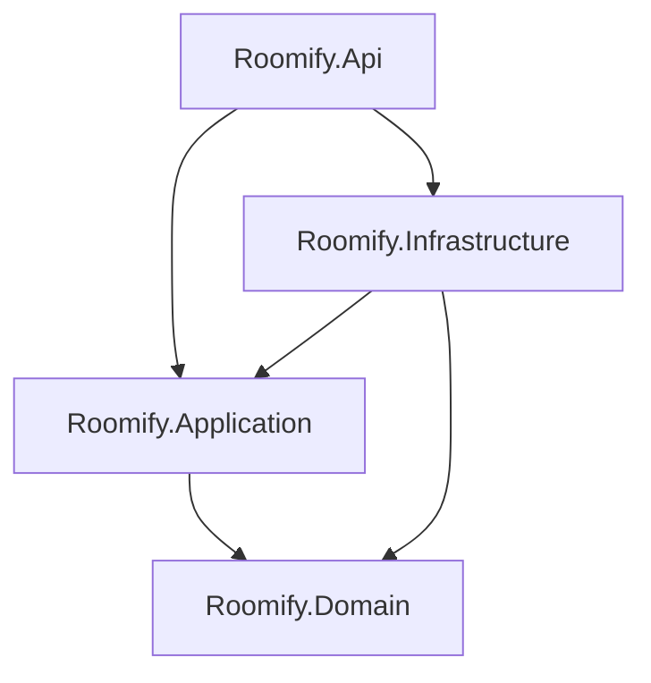

# Architektura Roomify

## Status i założenia

Dokument opisuje zatwierdzoną architekturę docelową WP-01.1. W WP-01.2 utworzono cztery projekty backendu, referencje, punkty rejestracji DI, obsługę kontrolerów i `/health`; szczegóły opisuje [BACKEND.md](BACKEND.md). WP-01.3 dodaje szkielet Angular CSR, layout, strony startową i 404 oraz testy kontrolne; szczegóły opisuje [FRONTEND.md](FRONTEND.md). W WP-01.4 przygotowano Docker Compose z Nginx, API i PostgreSQL, opisany w [DOCKER.md](DOCKER.md); uruchomienie trzech usług, healthchecki i proxy potwierdzono w ponownym odbiorze WP-01.6 po uruchomieniu Docker Desktop. WP-01.5 dodaje trzy projekty testowe .NET, fixture PostgreSQL, Stryker i Playwright, opisane w [dokumentacji testowania](../testing/README.md). WP-02.1 dodaje [model domenowy](DOMAIN.md) sal i rezerwacji z testami czasu i niezmienników. WP-02.2 dodaje [DbContext, mapowania EF i DI](PERSISTENCE.md), bez tworzenia tabel. WP-02.3 dodaje [Identity z cookies](IDENTITY.md) i wspólnym kontekstem; przypadki użycia, migracje i endpointy logowania pozostają planowane. Kontekst i wymagania pochodzą z [WP-00](../ai/PROJECT_CONTEXT.md), a decyzje technologiczne z [ADR](../decisions/README.md).

## Modularny monolit

Backend będzie jedną aplikacją wdrażaną jako całość. Obszary kont, sal, rezerwacji i dostępności mają zachować czytelne granice odpowiedzialności wewnątrz tej aplikacji. Nie wymagają osobnych procesów ani komunikacji między mikroserwisami. Cztery projekty techniczne reprezentują warstwy, a nie cztery osobne usługi.

## Warstwy i zależności projektów

| Projekt | Odpowiedzialność | Dozwolone zależności Roomify |
|---|---|---|
| Roomify.Domain | Encje, reguły biznesowe, typy wartości, statusy; logika bez infrastruktury | Brak |
| Roomify.Application | Przypadki użycia, serwisy aplikacyjne, interfejsy, DTO, koordynacja domeny | Domain |
| Roomify.Infrastructure | EF Core, PostgreSQL, Identity, implementacje dostępu do danych i migracje | Application, Domain |
| Roomify.Api | Kontrolery/endpointy, konfiguracja zależności, middleware, uwierzytelnianie i autoryzacja, błędy HTTP | Application, Infrastructure |

Strzałka oznacza zależność projektu źródłowego od wskazanego projektu. Jest to diagram referencji, a nie kolejność wywołań.

Api jest miejscem składania zależności: wywołuje `AddApplication()` i `AddInfrastructure(builder.Configuration, builder.Environment)`. Infrastructure rejestruje Scoped RoomifyDbContext z UseNpgsql bez połączenia przy starcie; Application nadal nie ma usług biznesowych. Docelowo powiąże interfejsy Application z implementacjami Infrastructure. Domain nie odwołuje się do HTTP, EF Core, Identity ani PostgreSQL. Referencje projektowe odpowiadają diagramowi.

## Przepływ komunikacji

Angular 22 będzie renderować interfejs w przeglądarce (CSR), korzystając ze Standalone Components, Reactive Forms, Signals i RxJS. Żądania HTTP z danymi JSON będą kierowane do API; cookies posłużą do uwierzytelniania sesji. Backend będzie egzekwować uprawnienia niezależnie od widoczności elementów interfejsu. Szczegóły ochrony żądań zmieniających stan przed CSRF oraz konfiguracji cookies i pochodzenia zostaną ustalone podczas konfiguracji uwierzytelniania.

Api przyjmie żądanie, wywoła przypadek użycia Application i przełoży wynik na odpowiedź HTTP. Application skoordynuje reguły Domain oraz dostęp do danych przez interfejsy. Infrastructure wykona operacje EF Core na PostgreSQL; migracje będą opisywać przyszłe zmiany schematu. Angular nie będzie łączyć się bezpośrednio z bazą danych.

## Miejsce logiki biznesowej

Reguły niezależne od infrastruktury należą do Domain, a koordynacja przypadku użycia do Application. Walidacja formularza wspiera użytkownika, ale API pozostaje źródłem prawdy. Kontrolery nie powinny przejmować reguł domenowych.

Sprawdzenie dostępności przed zapisem nie gwarantuje bezpieczeństwa dwóch jednoczesnych żądań. Zgodnie z ADR-008 docelowa ochrona przed konfliktem będzie wymuszona również na poziomie PostgreSQL, z przewidywalną odpowiedzią API. Konkretny mechanizm i migracja zostaną opracowane później; obecnie nie wybieramy szczegółowej implementacji SQL. Identyfikatory i oznaczenia propozycji w [regułach WP-00](../ai/BUSINESS_RULES.md) pozostają zachowane.

## Uzasadnienie i testowalność

Monolit ogranicza koszty wdrożenia i konfiguracji w projekcie akademickim. Podział warstw pozwala zrozumieć osobno reguły, przypadki użycia, zapis danych i protokół HTTP bez rozbudowywania infrastruktury.

Domenę będzie można testować jednostkowo bez serwera i bazy. Testy Application zastąpią zależności mockami Moq. Testy integracyjne uruchomią API przez WebApplicationFactory i rzeczywisty PostgreSQL przez Testcontainers, aby sprawdzić mapowanie danych, tożsamość i współbieżność. Testy Angulara użyją Vitest i TestBed, a Playwright sprawdzi pełny przepływ przeglądarka → API → baza. Stryker.NET oceni skuteczność asercji dla krytycznej logiki. Szczegóły: [plan testowania](../testing/README.md).
