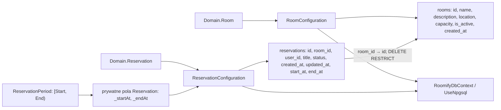

# EF Core i model relacyjny PostgreSQL — WP-02.2

> Aktualizacja 18.10.2026: opis WP-02.2/02.3 poniżej zachowuje historię. **WP-02.4 zakończono**; schemat istnieje, a fizyczne ograniczenia potwierdzono na PostgreSQL. Bieżący stan: [DATABASE.md](DATABASE.md) i [raport WP-02.4](../testing/WP02_4_REPORT.md).

## Cel i granice

ORM (Object-Relational Mapper) wiąże obiekty aplikacji z relacyjnymi tabelami: tłumaczy zapytania LINQ na SQL, materializuje wyniki i śledzi zmiany. Entity Framework Core jest ORM dla .NET; provider Npgsql dostosowuje go do PostgreSQL. W WP-02.2 skonfigurowano **model EF, nie schemat istniejącej bazy**. Nie ma migracji, tworzenia tabel, seedów, repozytoriów ani endpointów biznesowych.

`RoomifyDbContext` w Infrastructure przyjmuje `DbContextOptions<RoomifyDbContext>`. Udostępnia `Rooms` i `Reservations` jako DbSet, czyli punkty zapytań i śledzenia obiektów danego typu; DbSet nie jest kopią wszystkich wierszy w pamięci. Kontekst składa konfiguracje `IEntityTypeConfiguration<T>` przez ApplyConfigurationsFromAssembly. Każda konfiguracja opisuje jedną encję, bez reguł rezerwowania i bez otwierania połączenia.

Encja domenowa reprezentuje tożsamość i zachowanie biznesowe, tabela — sposób zapisu. Np. metoda Cancel nie jest kolumną, a Period składa się z dwóch kolumn tej samej tabeli. Domain zachowuje niezależność od EF, providerów, atrybutów bazodanowych i HTTP; Infrastructure zależy od Domain, nigdy odwrotnie. Application nadal nie zależy od Infrastructure.

## Pakiety i zgodność

W Infrastructure przypięto stabilne [Microsoft.EntityFrameworkCore 10.0.9](https://www.nuget.org/packages/Microsoft.EntityFrameworkCore/10.0.9) i [Npgsql.EntityFrameworkCore.PostgreSQL 10.0.3](https://www.nuget.org/packages/Npgsql.EntityFrameworkCore.PostgreSQL/10.0.3). Provider deklaruje EF/Relational >=10.0.4 i <11 oraz Npgsql >=10.0.3. Przywrócone wersje przechodnie obejmują EF.Relational 10.0.4, EF.Abstractions 10.0.9 i Npgsql 10.0.3; nie zakładamy identycznych numerów wszystkich zależności. Restore i build potwierdziły zgodność tego grafu.

Istniejącą DI.Abstractions w Infrastructure podniesiono z 10.0.0 do 10.0.9, ponieważ EF 10.0.9 wymaga tego minimum przez zależności. Nie zmieniano pakietów Application ani istniejących pakietów testowych. Design nie jest obecnie potrzebny — nie generujemy migracji i nie instalujemy dotnet-ef. Nie dodano SQL Server, SQLite, InMemory ani Identity. SDK: 10.0.301, projekty net10.0.

## Mapowanie



| Encja | Właściwość → kolumna | Typ / wymagania |
|---|---|---|
| Room | Id → id | uuid, PK, Guid nadawany przez domenę; ValueGeneratedNever |
| Room | Name → name | varchar(100), NOT NULL, unikalność bez rozróżniania wielkości liter |
| Room | Description → description | text, NULL, bez arbitralnego limitu długości |
| Room | Location → location | varchar(150), NOT NULL |
| Room | Capacity → capacity | integer, NOT NULL |
| Room | IsActive → is_active | boolean, NOT NULL |
| Room | CreatedAt → created_at | timestamptz, NOT NULL |
| Reservation | Id → id | uuid, PK, ValueGeneratedNever |
| Reservation | RoomId → room_id | uuid, NOT NULL, FK do rooms.id, Restrict |
| Reservation | UserId → user_id | uuid, NOT NULL; od WP-02.3 FK do users.id z Restrict, bez nawigacji w Domain |
| Reservation | Title → title | varchar(120), NOT NULL |
| Reservation | Status → status | varchar(9), NOT NULL: jawne `active` / `cancelled` |
| Reservation | CreatedAt / UpdatedAt | created_at NOT NULL / updated_at NULL, timestamptz |
| Reservation | StartAt / EndAt | start_at / end_at, timestamptz, NOT NULL, dostęp przez pola |

Status ma jawny converter, niezależny od numeracji enum i nazwy identyfikatora C#. Nieznany zapis ani nieobsługiwany enum nie stają się po cichu Cancelled — converter zgłasza błąd. Nie ma filtra anulowanych rezerwacji; historia pozostaje dostępna.

### Unikalność i indeksy

Model deklaruje `ux_rooms_name` z IsUnique i kolacją ICU `roomify_case_insensitive` (`und-u-ks-level2`, deterministic=false). Kolacja ignoruje wielkość liter, zachowując rozróżnienie akcentów. Jest zdefiniowana w modelu, bez wykonywania CREATE COLLATION na serwerze. Będzie wymagać obsługi ICU przy późniejszym wdrażaniu schematu. Npgsql opisuje ten mechanizm w [dokumentacji kolacji](https://www.npgsql.org/efcore/misc/collations-and-case-sensitivity.html). Indeks obejmuje również sale zarchiwizowane, bez nieuzgodnionego ponownego używania ich nazw. Same metadane nie dowodzą działania ograniczenia w niewdrożonej bazie.

Indeksy Reservation: `ix_reservations_room_period` (room_id, start_at, end_at), `ix_reservations_user_start` (user_id, start_at), `ix_reservations_period` (start_at, end_at). Prefiksy wspierają selekcję sali/użytkownika oraz zapytania o terminy. To zwykłe indeksy B-tree, bez gwarancji braku kolizji i bez deklarowania zmierzonej wydajności. Nie ma exclusion constraint ani ograniczenia współbieżności z WP-02.4. Restrict chroni przed kaskadowym usunięciem historii przy usuwaniu sali; zwykła archiwizacja zmienia IsActive.

## Dlaczego Period jest mapowany przez pola

Sprawdzono rzeczywisty sealed record ReservationPeriod z get-only Start/End oraz konstruktor Reservation przyjmujący Period i now. Próba ComplexProperty w EF 10 zakończyła budowanie modelu komunikatem „Cannot bind 'period', 'now'”. Log zachowano w ignorowanym `artifacts/wp022/complex-probe.log`. Dodatkowo indeksowanie skalarów wewnątrz complex types opisano dopiero dla EF 11 w [dokumentacji EF](https://learn.microsoft.com/en-us/ef/core/modeling/complex-types#keys-and-indexes-on-complex-type-properties). W tym projekcie pozostajemy przy EF 10 i wymaganych indeksach czasu.

Zastosowano dozwolone mapowanie jawnych pól: _startAt/_endAt są jedynym stanem końców okresu w Reservation. Publiczne StartAt/EndAt odczytują te pola; Period tworzy niemutowalny obiekt wartości z nich, a prywatne przypisanie Period zmienia oba pola razem. Nie ma drugiej, potencjalnie rozbieżnej kopii terminu. EF ignoruje Period i mapuje istniejące właściwości StartAt/EndAt przez HasField i PropertyAccessMode.Field. Nie powstaje encja Period, ukryty klucz ani kolumna JSON.

To jedyna zmiana encji produkcyjnej w Domain w tym pakiecie. Dodano także prywatny konstruktor Reservation z parametrami odpowiadającymi skalarnym właściwościom. Standardowe [wiązanie konstruktorów EF](https://learn.microsoft.com/en-us/ef/core/modeling/constructors) odtwarza tożsamość, status i metadane; konstruktor wywołuje istniejącą walidację identyfikatorów, tytułu i ReservationPeriod. Odczyt historii nie stosuje wymogu przyszłego startu, który dotyczy nowych operacji. Publiczna fabryka i metody zachowują pełną dotychczasową politykę. Nie dodano publicznych setterów, atrybutów ani ręcznej refleksji. Room i sam ReservationPeriod pozostały bez zmian. Room jest materializowany standardowym konstruktorem i mapowaniem pól automatycznych, co obejmuje test zachowania Id i archiwizacji.

Testy wykonują prawdziwy pipeline zapytania/materializacji EF/Npgsql, zastępując wyłącznie otwarcie połączenia i wynik odczytu publicznymi interceptorami EF. Nie jest to EF InMemory i nie jest to test SQL wykonanego przez PostgreSQL. Potwierdzono odtworzenie dawnych Active/Cancelled, UTC, metadanych, odrzucenie End≤Start i zmianę obu śledzonych końców po ChangePeriod.

## UTC i precyzja

Period nadal normalizuje wejściowe DateTimeOffset do offsetu zero; pola przejmują te chwile. Dla Npgsql [DateTimeOffset z timestamptz wymaga Offset=0](https://www.npgsql.org/doc/types/datetime.html#timestamps-and-timezones). Nie włączono legacy timestamp behavior i nie wykonuje się konwersji na strefę lokalną hosta. Warszawa służy walidacji godzin biznesowych, nie zmienia typu zapisu. Timestamptz przechowuje chwilę, nie identyfikator strefy ani oryginalny offset.

PostgreSQL ma rozdzielczość mikrosekundy, DateTimeOffset — 100 ns; metadane utworzenia/zmiany mogą przy późniejszym zapisie stracić ułamek mikrosekundy. Terminy domenowe mają pełne minuty, więc ta różnica nie zmienia ich znaczenia. Faktycznego round-trip do tabel nie wykonano, bo WP-02.2 zabrania ich tworzenia. Test materializacji korzysta z jawnych chwil UTC, a testy Domain z niezerowego offsetu wejściowego i obu zmian DST.

## Change tracking

DbContext śledzi odczytane/Attach obiekty i ich pierwotne wartości. DetectChanges porównuje bieżący stan z migawką. Po ChangePeriod EF widzi zmianę start_at i end_at mimo braku publicznych setterów. Test sprawdza stan Modified oraz stare i nowe wartości. SaveChanges docelowo tłumaczy takie różnice na SQL; na tym etapie go nie wywołujemy. Kontekst jest Scoped: jeden w danym zakresie DI, inny w następnym. Nie należy współdzielić go między równoległymi operacjami.

## DI i konfiguracja połączenia

Api wywołuje `AddInfrastructure(builder.Configuration)`. Infrastructure rejestruje Scoped RoomifyDbContext i UseNpgsql. Kolejność wyboru konfiguracji:

1. `ConnectionStrings:Roomify` (np. zmienna środowiska `ConnectionStrings__Roomify`) — lokalne narzędzia i niezależna konfiguracja testów.
2. Sekcja `Database:Host/Port/Name/Username/Password` — istniejące `Database__*` z Compose. NpgsqlConnectionStringBuilder prawidłowo zabezpiecza składanie wartości z separatorami.
3. Brak obu: provider bez connection stringa pozwala zbudować model i rozwiązać DI; rzeczywiste zapytanie będzie wymagało konfiguracji. Nie używamy cichego połączenia z bazą developerską ani domyślnego hasła.

W Compose host bazy to `db`, port 5432. Z Windows jest to 127.0.0.1 i port opublikowany przez POSTGRES_HOST_PORT. Lokalny dotnet run nie wczytuje .env. Dla lokalnego uruchomienia ustaw własne `Database__Host`, `Database__Port`, `Database__Name`, `Database__Username`, `Database__Password` w środowisku procesu lub pełne ConnectionStrings__Roomify; wartości nie trafiają do repozytorium. .env jest ignorowany i wykorzystywany wyłącznie przez Compose. Testy metadanych używają opcji providera bez połączenia, a testy DI — jawnej konfiguracji testowej, bez .env.

Opcje są składane przy rozwiązaniu kontekstu, bez OpenConnection, CanConnect, migracji i EnsureCreated. Niepoprawny format konfiguracji może zgłosić błąd przy tworzeniu kontekstu; brak dostępności poprawnie wskazanego serwera nie uniemożliwia startu hosta. /health zachowuje liveness bez PostgreSQL. Nie dodano readiness bazy — można ją wydzielić w przyszłości, gdy zostanie zlecona. Nie włączono logowania wrażliwych parametrów ani szczegółowych danych.

## Testy i dalszy etap

Z katalogu głównego:

```powershell
dotnet restore backend/Roomify.slnx
dotnet build backend/Roomify.slnx --configuration Debug --no-restore
dotnet build backend/Roomify.slnx --configuration Release --no-restore
dotnet test backend/tests/Roomify.Domain.UnitTests --no-restore
dotnet test backend/tests/Roomify.Application.UnitTests --no-restore
dotnet test backend/tests/Roomify.Api.IntegrationTests --no-restore --filter "Category=PersistenceMetadata"
dotnet test backend/tests/Roomify.Api.IntegrationTests --no-restore --filter "FullyQualifiedName~HealthCheckTests"
# Wszystkie przypadki bez Dockera (metadane EF i dotychczasowe HTTP):
dotnet test backend/tests/Roomify.Api.IntegrationTests --no-restore --filter "RequiresDocker=false"
```

Wyniki WP-02.2: Domain 87/87, EF/DI/materializacja 35/35, istniejące HTTP 3/3. Application ma 0 przypadków. Logi i TRX w ignorowanym artifacts/wp022; pełna [tabela AC i raport](../testing/WP02_2_REPORT.md). Dawne 85 testów domeny zachowano, dodając dwa sprawdzające UTC pól i niezmienność pobranej migawki Period.

Nie wygenerowano migracji ani SQL wdrożeniowego. Metadane nie tworzą tabel. **WP-02.3 wykonano**: [IDENTITY.md](IDENTITY.md) opisuje rozszerzenie tego samego kontekstu do IdentityDbContext<ApplicationUser, IdentityRole<Guid>, Guid>, siedem encji Identity i wymagany FK użytkownika. Bazowe konfiguracje biznesowe pozostają zachowane; tabela powyżej uwzględnia nową relację. Bezpośredni DI.Abstractions stał się redundantny wobec FrameworkReference Microsoft.AspNetCore.App i został usunięty, a EF.Relational został podniesiony przechodnio do 10.0.9 przez Identity.EF 10.0.9. Opis wersji i wykonania WP-02.2 powyżej jest historią tego etapu. Przed wdrożeniem schematu WP-02.4 trzeba zweryfikować ICU/unikalność i rzeczywisty zapis/odczyt z osobnym PostgreSQL testowym; opis powyżej zachowuje stan historyczny przed WP-02.4.
