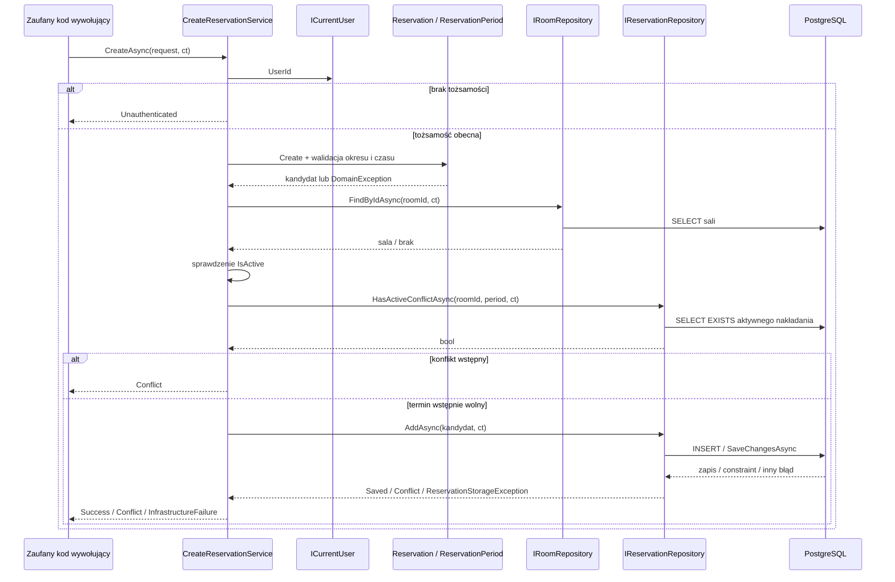
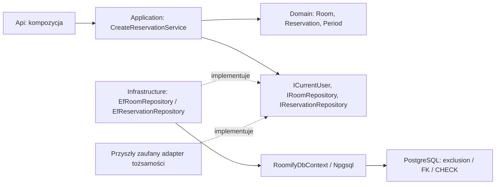

# Tworzenie rezerwacji — Application, WP-03.1

> Aktualizacja WP-03.4: poniższy opis zachowuje zakres poprzedniego etapu. Wspólny ApplicationAccess sprawdza teraz IsActive, a produkcyjny adapter Identity i walidacja cookies co żądanie są zaimplementowane. [Zarządzanie kontami](USER_MANAGEMENT.md), [bieżący raport](../testing/WP03_4_REPORT.md). Produkcyjne endpointy logowania/biznesowe nadal nie istnieją.


> Aktualizacja WP-03.2: poniżej zachowano opis tworzenia i wyniki WP-03.1. Wspólne typy mają obecnie nazwy ReservationOperationResult/Status/Details, a repozytorium obsługuje też odczyt/Save i własne ID. Wszystkie Create testy nadal przechodzą. Edycja/anulowanie, uprawnienia i xmin: [RESERVATION_MANAGEMENT.md](RESERVATION_MANAGEMENT.md); aktualna regresja 362/362 i [raport WP-03.2](../testing/WP03_2_REPORT.md). Nowa migracja modelu/historii jest przetestowana, developerka nadal bez zmian.

Stan zweryfikowany 18.10.2026. [Raport, wyniki i 26 kryteriów](../testing/WP03_1_REPORT.md), [macierz wymagań](../testing/REQUIREMENTS_TRACEABILITY.md). Nie ma kontrolera/endpointu HTTP ani nowego UI; to pierwszy przypadek użycia wywoływany przez zaufany kod aplikacji.

## 1. Przypadek użycia

`CreateReservationService.CreateAsync(request, cancellationToken)` pobiera zaufaną tożsamość, waliduje dane i czas przez istniejącą domenę, sprawdza istnienie/aktywność sali oraz dostępność, a następnie zapisuje rezerwację przez repozytorium. Rezerwacja zawsze należy do bieżącego użytkownika; wejście nie zawiera UserId.

Walidacja niepoprawnych danych kończy się przed pierwszym odczytem bazy. `Reservation.Create` wraz z `ReservationPeriod` tworzy wtedy poprawnego kandydata w pamięci. Nie jest on jeszcze dodany do DbContext ani zapisany; po brakującej/nieaktywnej sali lub konflikcie jest odrzucany. Ten wybór pozwala wykonać istniejącą walidację domenową raz, bez kopiowania reguł do Application. Nowy Guid kandydata nie jest dowodem zapisu — wynik Success powstaje dopiero po poprawnym SaveChangesAsync.

## 2. Sekwencja



Diagram pokazuje główny przepływ; InvalidInput, RoomNotFound i RoomInactive kończą operację przed kolejnymi krokami. Anulowanie przez CancellationToken jest propagowane jako OperationCanceledException, nie jako konflikt czy walidacja.

## 3. Zależności



Application referencjonuje wyłącznie Domain i istniejące DI.Abstractions. Nie zna DbContext, Npgsql, Identity ani HttpContext. Infrastructure implementuje kontrakty Application i zna provider. Domain, mapowania, InitialCreate i snapshot nie wymagały zmian. Nie dodano MediatR, GenericRepository ani frameworka CQRS.

## 4. Wejście i wyniki

`CreateReservationRequest`: **RoomId (Guid), Title (string?), StartAt i EndAt (DateTimeOffset)**. Nie zawiera UserId. Period normalizuje poprawne chwile do UTC; godziny biznesowe nadal odnoszą się do Europe/Warsaw.

`CreateReservationResult` ma get-only `Status`, `Reservation`, `ErrorCode`. Konstruktor i fabryki są niedostępne dla klienta zewnętrznego. Success zawiera `ReservationCreated`: Id, RoomId, UserId, znormalizowany Title, StartAt, EndAt, Status i CreatedAt. Błąd nie zawiera rezerwacji ani szczegółów SQL/wyjątku. Model wynikowy nie udostępnia mutowalnej encji domenowej.

| Status | ErrorCode / znaczenie |
|---|---|
| Success | Brak ErrorCode; zapis potwierdzony, dane w Reservation |
| InvalidInput | reservation.requestRequired lub kod istniejącej reguły domenowej, np. BR-001/002/007/008/014/015/024, reservation.roomId |
| RoomNotFound | reservation.roomNotFound |
| RoomInactive | reservation.roomInactive |
| Conflict | reservation.conflict: precheck albo właściwy exclusion przy zapisie |
| Unauthenticated | reservation.unauthenticated: brak UserId lub Guid.Empty |
| InfrastructureFailure | reservation.storageFailure: odrębny błąd persystencji |

Nie ma kodów HTTP. Przyszły endpoint dobierze kontrakt transportowy i neutralne komunikaty. Nie zwracamy klientowi treści DomainException.Message ani NpgsqlException; kod reguły domenowej pozwala rozróżnić walidację.

## 5. Repozytoria i dostępność

`IRoomRepository.FindByIdAsync` zwraca Room albo null; implementacja używa AsNoTracking/SingleOrDefaultAsync po PK. Application sprawdza IsActive — samo istnienie sali nie wystarcza.

`IReservationRepository.HasActiveConflictAsync` używa `AnyAsync`, które provider tłumaczy na **EXISTS** z warunkami:

```text
room_id = żądana sala
AND status = active
AND start_at < żądany koniec
AND end_at > żądany początek
```

Nie materializuje wszystkich rezerwacji i nie filtruje po dacie kalendarzowej. To ten sam półotwarty warunek geometrii co Overlaps; wyrażenie SQL jest konieczną implementacją kontraktu w Infrastructure. Nie wywołujemy nietłumaczalnej domenowej metody na rekordach EF ani nie kopiujemy walidacji czasu z Domain. Styk jest dozwolony, cancelled i inne sale nie blokują.

`AddAsync` dodaje jedną rezerwację i wywołuje SaveChangesAsync. Zwraca Saved/Conflict albo zgłasza kontrolowany ReservationStorageException. Jedno SaveChanges stanowi granicę zapisu; nie dodano osobnej jednostki pracy do pojedynczego INSERT. Scoped kontekst tego przypadku użycia nie powinien zawierać cudzych niezapisanych modyfikacji, ponieważ SaveChanges zapisuje wszystkie śledzone zmiany zakresu. Po nieudanym zapisie repozytorium odłącza własnego kandydata, nie czyści całego trackera i nie usuwa innych encji.

## 6. Dependency Injection

`AddApplication`: Scoped CreateReservationService, Scoped ICurrentUser z domyślnym adapterem nieuwierzytelnionym i Singleton TimeProvider.System. `TryAdd` zachowuje jawne implementacje tożsamości i zegara oraz nie duplikuje rejestracji Application. Testy mogą podstawić kontrolowany zegar i zaufaną tożsamość przed rejestracją lub jawnie zastąpić rejestrację w kompozycji.

`AddInfrastructure`: istniejący Scoped RoomifyDbContext oraz Scoped IRoomRepository → EfRoomRepository i IReservationRepository → EfReservationRepository. Rejestracja nie otwiera połączeń ani nie wykonuje zapytań. Api już wywoływało obie metody rejestracji; Program.cs pozostał bez zmian. Testy potwierdzają zakresy, brak duplikatów Application, zachowanie override'ów i zamknięte połączenie przy braku tożsamości.

## 7. Aktualny użytkownik

`ICurrentUser.UserId` jest nullable Guid. Null i Guid.Empty oznaczają brak zaufanej tożsamości. Domyślny wewnętrzny UnauthenticatedCurrentUser zawsze zwraca null, więc uruchomiony obecnie host nie otrzymuje fikcyjnego konta ani możliwości tworzenia rezerwacji w imieniu dowolnego użytkownika.

W tym etapie nie ma adaptera HttpContext/claims ani logowania. Przyszła kompozycja musi podłączyć **zaufany adapter**, który rozpoznaje uwierzytelnienie, odczytuje Guid Identity i egzekwuje odpowiedni stan konta. Testy używają wyłącznie zaufanej implementacji z faktycznie istniejącym użytkownikiem w bazie Testcontainers. Nie ma pola klienta pozwalającego podstawić innego właściciela.

Brak istnienia użytkownika przy zapisie zostaje fizycznie odrzucony przez FK i daje InfrastructureFailure; nie dodano osobnego repozytorium kont ani polityk sesji. **Aktywność konta/odebranie sesji po dezaktywacji nadal wymaga przyszłej integracji Identity**. Nie deklarujemy pełnego BR-013/021 na podstawie tej abstrakcji.

## 8. Walidacja domenowa i aplikacyjna

Domain: dodatni okres, wymagane identyfikatory i tytuł po trim, przyszły początek, maksymalnie 8 h, minuty, jeden dzień lokalny oraz godziny 08–20 Europe/Warsaw. Używamy istniejących Reservation.Create/ReservationPeriod/ReservationTimePolicy, bez zmian w Domain.

Application: obecność zaufanego użytkownika i żądania, istnienie/aktywność sali, wstępna dostępność, kolejność zależności i rezultat. W przypadku błędu nie uruchamia dalszych kroków ani zapisu. Dane błędne nie powodują odczytu bazy; brak użytkownika ma pierwszeństwo przed odczytem/walidacją danych zasobu.

PostgreSQL: końcowa integralność FK, CHECK, unikalności i exclusion. /health pozostaje liveness; nowy serwis nie zmienia sposobu uruchamiania hosta ani nie migruje bazy.

## 9. Rozpoznawanie błędów PostgreSQL

Tylko para **SqlState = 23P01 i ConstraintName = ex_reservations_active_period** wewnątrz DbUpdateException daje ReservationWriteOutcome.Conflict. INT-RES-008 potwierdza to po rzeczywistym zajęciu terminu pomiędzy SELECT a INSERT. INT-RES-009 dowodzi, że FK 23503 i inny exclusion o tym samym kodzie 23P01 nie są maskowane jako konflikt terminu.

Pozostałe błędy DB/EF/timeout są zamieniane w neutralny ReservationStorageException, który Application tłumaczy na InfrastructureFailure. Klasyfikator uwzględnia też opakowanie InvalidOperationException → DbUpdateException → PostgresException używane przez NpgsqlExecutionStrategy dla błędów przejściowych. Nie przechwytuje dowolnego błędu programistycznego jako walidacji ani konfliktu. Anulowanie jest propagowane.

Nie dodano retry ani utożsamiania deadlocka 40P01 z kolizją terminów. Przy 40P01 wynik to InfrastructureFailure, nie Conflict. Nie przekazuje on klientowi kodu SQLSTATE ani SQL; diagnostyka kodu w testach pochodzi z testowego interceptora rzeczywistej komendy. Automatyczne ponawianie wymaga jawnej polityki całej transakcji i rozpatrzenia niepewnego skutku błędów połączenia; pozostaje ograniczeniem na kolejny zakres.

## 10. Współbieżność i granice gwarancji

Precheck nie rezerwuje terminu. Dwa wywołania mogą równocześnie zobaczyć wolny przedział; istniejący exclusion GiST jest ostateczną ochroną INSERT. Nie ma procesu lock w pamięci ani serializacji wszystkich żądań.

INT-RES-007 używa dwóch zakresów DI, odrębnych DbContext/połączeń i wspólnej bariery **po dwóch prawdziwych odczytach dostępności**, przed zapisami. Limit 20 s, bez Task.Delay. Dokładnie jeden rezultat musi być Success, w bazie jeden aktywny rekord, a wynik odrzucenia musi odpowiadać faktycznie przechwyconemu kodowi PostgreSQL. 23P01 → Conflict; 40P01 → InfrastructureFailure. Timeout, inny kod albo dwa sukcesy to FAIL. Końcowa seria 6/6: jeden Success i jeden Conflict w każdej próbie. Poprzednia poprawna seria miała jeden 40P01, poprawnie odróżniony od konfliktu.

Sprawdzenie aktywności sali dotyczy chwili odczytu; nie dodano mechanizmu koordynacji z przyszłym równoczesnym przypadkiem archiwizacji sali. Nie ma jeszcze aktywnych sesji HTTP, autoryzacji zasobów, CSRF ani API kalendarza. Ten etap nie udostępnia osobnego przypadku użycia odczytu kalendarza — sprawdzanie dostępności jest portem używanym przy tworzeniu.

## 11. Testy

Application: **32/32**, xUnit + Moq 4.20.72, bez bazy i Dockera. Poprawne dane, błędy czasu/tytułu/ID, brak żądania/użytkownika/sali, nieaktywność, kolizje i granice, cancelled, inna sala, błąd zapisu, błędy każdego repozytorium, propagacja CancellationToken oraz brak UserId w kontrakcie. Mocks potwierdzają brak zapisu po walidacji i niepożądanych odczytów.

Nowe integracyjne: **24/24** — 21 PostgreSQL obejmujących INT-RES-001–009 i inną salę, 3 kompozycji/awarii połączenia bez Dockera. Używają InitialCreate i osobnych baz Testcontainers. Test SQL potwierdza EXISTS, rzeczywisty round-trip, status i UTC. Testy błędów sprawdzają odłączenie nieudanego kandydata i brak ponownego przypadkowego zapisu.

Pełny backend: **280/280** (Domain 110, Application 32, integracyjne 138). W tych 138: 75 bez Dockera i 63 PostgreSQL. Wcześniejsze 114 testów integracyjnych i 110 Domain zachowano. Stryker dla samego CreateReservationService: **100% — 19/19 badanych Killed**, bez Survived/NoCoverage/Timeout; szczegóły wygenerowanych/niekompilujących się/wykluczonych mutantów i rozbieżności licznika JSON są jawne w raporcie. Historyczny wynik Domain nie był ponownie mierzony.

## 12. Uruchamianie

Z katalogu głównego, SDK .NET 10 i Docker Linux dla testów PostgreSQL:

```powershell
dotnet tool restore
dotnet restore backend/Roomify.slnx
dotnet build backend/Roomify.slnx --configuration Debug --no-restore
dotnet build backend/Roomify.slnx --configuration Release --no-restore
dotnet test backend/tests/Roomify.Application.UnitTests --no-restore
dotnet test backend/tests/Roomify.Api.IntegrationTests --filter "Category=ReservationApplication|Category=ApplicationComposition"
dotnet test backend/Roomify.slnx --no-restore --logger "trx;LogFilePrefix=wp031" --results-directory artifacts/wp031/regression
```

Analiza mutacyjna nowej logiki, z katalogu backend/tests/Roomify.Application.UnitTests:

```powershell
dotnet stryker --config-file stryker-config.json --output ../../../artifacts/wp031/mutation-application --skip-version-check --concurrency 4
```

Wszystkie logi/TRX/HTML/JSON są lokalnie w ignorowanym artifacts/wp031. Testy nie korzystają z developerskiej .env i nie modyfikują roomify_dev. Porównanie logicznego dumpa i historii przed/po wykazało brak zmian. Nie wykonywano migracji developerskiej, seeda, commit ani push; WP-03.2 nie rozpoczęto.
