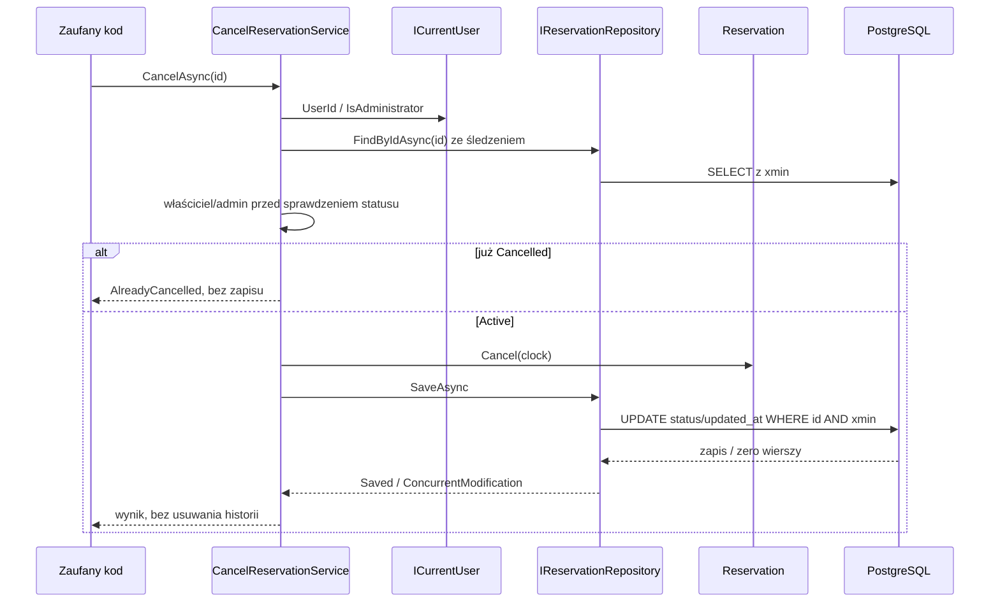

# Edycja i anulowanie rezerwacji — WP-03.2

> Aktualizacja WP-03.4: poniższy opis zachowuje zakres poprzedniego etapu. Wspólny ApplicationAccess sprawdza teraz IsActive, a produkcyjny adapter Identity i walidacja cookies co żądanie są zaimplementowane. [Zarządzanie kontami](USER_MANAGEMENT.md), [bieżący raport](../testing/WP03_4_REPORT.md). Produkcyjne endpointy logowania/biznesowe nadal nie istnieją.


Stan: **18.10.2026**. [Raport wykonania i 25 AC](../testing/WP03_2_REPORT.md), [macierz wymagań](../testing/REQUIREMENTS_TRACEABILITY.md). To dwa przypadki użycia Application, bez endpointów HTTP, adaptera claims, logowania i UI. Istniejące tworzenie z WP-03.1 nadal działa.

## 1. Edycja

`UpdateReservationService.UpdateAsync` przyjmuje UpdateReservationRequest: ReservationId, Title, StartAt, EndAt. Identyfikator użytkownika, rola, RoomId i Status nie są danymi wejściowymi. Serwis sprawdza kolejno uwierzytelnienie, poprawny identyfikator żądania, istnienie rezerwacji, właściciela/administratora, status, walidację domenową planowanych danych, istnienie/aktywność sali oraz dostępność z wykluczeniem własnego ID. Następnie zmienia tę samą encję i zapisuje ją przez Infrastructure.

Domain otrzymał minimalne `ValidateUpdate` (bez skutków ubocznych) i atomowe `UpdateDetails` oraz prywatny setter Title. Obie metody korzystają z tego samego ValidateDetails, istniejącego DomainGuard, EnsureCanChange i ReservationTimePolicy. Nie tworzymy nowej rezerwacji do walidacji. Id/RoomId/UserId/CreatedAt pozostają niezmienne; tytuł jest trimowany i walidowany 1–120 znaków. Validation przed precheck nie modyfikuje trackowanej encji, więc błąd sali/dostępności nie pozostawia oczekujących zmian. Właściwa aktualizacja ponownie sprawdza czas przy mutacji, po asynchronicznych odczytach.

Edycja obejmuje tytuł i okres w tej samej sali. Nie dodano przenoszenia między salami, zmiany właściciela ani przywracania anulowanego rekordu. Reguły czasu i aktywności sali obowiązują także administratora.

## 2. Anulowanie

`CancelReservationService.CancelAsync` przyjmuje tylko ReservationId. Po sprawdzeniu tożsamości, istnienia i uprawnień wywołuje istniejące `Reservation.Cancel(TimeProvider)` i zapisuje zmianę. Rekord pozostaje w historii; Status staje się Cancelled i UpdatedAt otrzymuje czas operacji. Exclusion obejmuje jedynie Active, więc slot jest wolny dla nowego tworzenia przez Application.

Przy już anulowanym rekordzie wynik to **AlreadyCancelled**, bez zapisu i bez zmiany UpdatedAt/xmin. Jest to jawna reprezentacja idempotentnego stanu, zgodna z istniejącą metodą Domain; działa także po pierwotnym początku rezerwacji. Nie wywołujemy DELETE ani nie przywracamy statusu Active. Pierwsze anulowanie rezerwacji rozpoczętej odrzuca istniejące BR-017.

## 3. Sekwencje

```mermaid
sequenceDiagram
    participant C as Zaufany kod
    participant A as UpdateReservationService
    participant U as ICurrentUser
    participant R as IReservationRepository
    participant D as Reservation
    participant B as PostgreSQL
    C->>A: UpdateAsync(request)
    A->>U: UserId / IsAdministrator
    A->>R: FindByIdAsync(id) ze śledzeniem
    R->>B: SELECT z xmin
    R-->>A: encja + oryginalny token w EF
    A->>A: właściciel/admin i stan
    A->>D: ValidateUpdate bez mutacji
    A->>A: aktywna sala
    A->>R: HasActiveConflictExcludingAsync(..., id)
    R->>B: EXISTS aktywnego nakładania, id != własne
    A->>D: UpdateDetails(title, period, clock)
    A->>R: SaveAsync(ta sama encja)
    R->>B: UPDATE ... WHERE id AND xmin; RETURNING xmin
    B-->>R: zapis / zero wierszy / exclusion
    R-->>A: Saved / ConcurrentModification / Conflict
    A-->>C: wspólny ReservationOperationResult
```



Wcześniejsze błędy kończą operację przed kolejnymi krokami. Diagramy pokazują ścieżki poprawnej tożsamości; brak tożsamości zawsze kończy się przed odczytem bazy.

## 4. Uprawnienia

Rozszerzono istniejący `ICurrentUser` o `IsAdministrator`, domyślnie false. Nie ma zależności Application od Identity/HttpContext. Wspólny, mały `ReservationAccess` rozpoznaje Guid różny od null/Empty i prawo `właściciel || administrator`. Sama flaga administratora bez tożsamości nie umożliwia operacji. Starsze adaptery zachowują bezpieczny brak uprawnień administratora.

Sprawdzenie uprawnień poprzedza ujawnienie statusu i walidację nowego terminu. Forbidden/Unauthenticated nie zawierają danych cudzej rezerwacji. ReservationNotFound i Forbidden są odrębnymi rezultatami zgodnie z zakresem; nie twierdzimy, że ukrywają samo istnienie zasobu. Realne rozpoznanie ról/aktywności konta wymaga przyszłego zaufanego adaptera Identity, nie wartości z requestu.

## 5. Statusy i wspólny wynik

Uogólniono istniejące typy WP-03.1 zamiast tworzyć drugi mechanizm Result: **CreateReservationResult → ReservationOperationResult**, CreateReservationStatus → ReservationOperationStatus, ReservationCreated → ReservationDetails. Tworzenie, edycja i anulowanie korzystają z tego samego kontraktu; wszystkie wcześniejsze asercje dostosowano mechanicznie do nazw. ReservationDetails zawiera też UpdatedAt. Jest to zmiana nazw API C# przed powstaniem transportu HTTP; przyszły kod wywołujący musi używać aktualnych typów.

| Wynik | Znaczenie |
|---|---|
| Success | Dane encji po potwierdzonym zapisie |
| InvalidInput | Walidacja żądania/domeny, np. reservation.idRequired lub BR-001/002/007/008/014/015/017/024; odpowiednik ValidationError w tym mechanizmie |
| Unauthenticated | Brak zaufanego identyfikatora użytkownika |
| ReservationNotFound | Nie znaleziono rezerwacji |
| Forbidden | Istnieje rezerwacja, brak prawa zarządzania; bez jej danych |
| AlreadyCancelled | Edycja anulowanej albo powtórne anulowanie; brak zapisu |
| RoomNotFound / RoomInactive | Edytowana rezerwacja nie spełnia warunków sali |
| Conflict | Konflikt terminu z inną rezerwacją (odpowiednik ReservationConflict) |
| ConcurrentModification | Inna operacja zmieniła/usunęła odczytaną wersję |
| InfrastructureFailure | Odrębny błąd magazynu danych, bez SQL/connection stringa/wyjątków providera |

Każdy błąd zawiera stały ErrorCode i null zamiast Reservation. Nie zwracamy HTTP. CancellationToken propaguje OperationCanceledException. Ponowne anulowanie po przegranej wersji wymaga jawnego odczytu nowego stanu; nie wykonujemy tego automatycznie.

## 6. Terminy i sala

ReservationPeriod/ReservationTimePolicy nadal realizują dodatni okres, przyszły początek, maksymalnie 8 h, minuty, jeden lokalny dzień i 08–20 Europe/Warsaw. EnsureCanChange odrzuca zmianę nieaktywnej/rozpoczętej rezerwacji. Nie skopiowano reguł czasu do Application.

`HasActiveConflictExcludingAsync` wykonuje SQL EXISTS: ta sama sala, aktywny status, `id <> edytowane ID`, `start_at < nowy koniec` i `end_at > nowy początek`. Nie pobiera listy ani nie filtruje jedynie po dniu. Ten sam okres nie koliduje z własnym rekordem. Wstępny brak kolizji nie rezerwuje slotu; ostateczne ograniczenie jest w bazie.

## 7. Dwa konflikty

**Terminy różnych rezerwacji:** istniejący exclusion GiST ex_reservations_active_period. Repozytorium rozpoznaje dokładnie PostgresException 23P01 i tę nazwę, zwracając Conflict; inny exclusion/FK/40P01 nie stają się konfliktem terminu. Dotychczasowe testy WP-03.1 nadal sprawdzają tę granicę.

**Wersje tego samego rekordu:** natywne xmin i optymistyczna współbieżność EF. Wynik to ConcurrentModification, odrębny od 23P01 i błędu infrastruktury. Nie ponawiamy ślepo zapisu, bo mógłby nadpisać nowsze dane. 40P01 nadal pozostaje InfrastructureFailure zgodnie z WP-03.1, bez retry.

## 8. Optimistic concurrency

EF zapamiętuje token odczytanego wiersza jako OriginalValue. UPDATE zawiera predykat ID oraz **oryginalne xmin**. Jeśli inna transakcja wcześniej zapisała wiersz, token się zmienia i UPDATE trafia w zero rekordów. EF zgłasza DbUpdateConcurrencyException; kod użytkownika nie nadpisuje nowego stanu. Po sukcesie RETURNING xmin aktualizuje wersję w trackerze.

To gwarancja dla dwóch operacji, które odczytały tę samą wersję, a nie blokada procesu. Request nie zawiera wersji klienta/ETag; nie rozwiązujemy tu wykrywania dowolnej starej kopii formularza sprzed rozpoczęcia serwerowego odczytu. Jedna Scoped jednostka pracy powinna obsługiwać jeden przypadek użycia i nie zawierać cudzych oczekujących zmian. Nie współdzielimy DbContext między równoległymi operacjami.

## 9. PostgreSQL, EF i migracja

Mapowanie w ReservationConfiguration: `Property<uint>("xmin").HasColumnType("xid").IsRowVersion()`. To właściwość shadow, poza Domain i DTO. PostgreSQL utrzymuje xmin jako systemowy atrybut transakcji; **nie dodano kolumny biznesowej, setterów wersji ani zegara jako tokenu**. [Oficjalna dokumentacja Npgsql](https://www.npgsql.org/efcore/modeling/concurrency.html).

Nowa migracja **20261018104209_ReservationOptimisticConcurrency** utrwala zmianę modelu i snapshotu. Wygenerowane AddColumn/DropColumn xmin są rozpoznawane przez Npgsql i pomijane w DDL. Przejrzany SQL Up zawiera wyłącznie transakcję i INSERT do __EFMigrationsHistory. Test na istniejącym rekordzie pod InitialCreate wykonał Up, Down do InitialCreate i ponowne Up: dane, xmin i natywny atrybut zachowane. InitialCreate i jego designer nie zmieniły się. Snapshot jest aktualny.

**Developer roomify_dev nie był migrowany w WP-03.2**: historia nadal tylko InitialCreate, nowa migracja oczekuje na jawne zastosowanie podczas wdrożenia. Fizyczny xmin istnieje już w tej bazie, więc nie brakuje kolumny runtime. Przyjęto przygotowanie/przetestowanie migracji bez zmiany developerskich danych ani historii. Po wyborze i zweryfikowaniu właściwego środowiska można wykonać standardowe `dotnet ef database update --project backend/src/Roomify.Infrastructure --startup-project backend/src/Roomify.Infrastructure`; konfigurację procesu i sekrety opisuje [DATABASE.md](DATABASE.md). Nie ma automatycznej migracji przy starcie API.

Systemowe xmin nie jest trwałym globalnym identyfikatorem do używania poza protokołem wersji odczyt/zapis, np. jako wieczny identyfikator domenowy lub po backup/restore. API nie ujawnia go w tym etapie.

## 10. Obsługa DbUpdateConcurrencyException

Wspólne PersistAsync obsługuje Add/Save. Najpierw przechwytuje DbUpdateConcurrencyException i odłącza własną encję, zwracając ReservationWriteOutcome.ConcurrentModification. Dopiero osobno rozpoznaje właściwy exclusion, a następnie inne błędy persystencji. Wspólny ReservationSaveResults mapuje Saved/Conflict/ConcurrentModification na wynik każdej operacji, bez zwracania wyjątków EF/Npgsql do klienta.

FindByIdAsync czyta **ze śledzeniem**. SaveAsync wymaga encji z tego samego kontekstu; nie stosuje Update/AsNoTracking/Attach z wymyślonym xmin. Po konflikcie nie wykonuje automatycznego reload/retry ani nie kasuje wszystkich śledzonych encji. Baza pozostaje w stanie zwycięskiej operacji, a klient otrzymuje neutralny kod reservation.concurrentModification.

## 11. Mapowanie i granice

Scoped: Create/Update/Cancel, oba repozytoria, domyślny adapter i DbContext. Singleton: TimeProvider, z możliwością kontrolowanego override. Rejestracja nie wykonuje zapytań; rozszerzono test DI o oba nowe serwisy, zakresy i brak duplikatów. Application nie zna Infrastructure/EF/Identity/HttpContext, a Domain pozostaje niezależny.

Nie zmieniono WP-00, endpointów, auth HTTP, CRUD sal ani UI. Aktywność konta i bezpieczeństwo sesji/CSRF nadal wymagają przyszłego adaptera; bieżący IsAdministrator ma pochodzić z zaufanej tożsamości. Nie dodano koordynacji z przyszłym równoczesnym procesem archiwizacji sali. Nie przenosimy ani nie zmieniamy właściciela rezerwacji.

## 12. Testy i rzeczywiste wyniki

Końcowo **362/362**: Domain 116, Application 87, integracyjne 159 (75 bez Dockera i 84 PostgreSQL). Nowe 6 przypadków Domain sprawdza atomową aktualizację i walidację bez mutacji; Application dodaje 55 przypadków (edycja 37, anulowanie 18) do wcześniejszych 32. Nowa klasa ReservationManagementTests ma **21/21 PostgreSQL**, mapując wszystkie INT-UPD-001–007, INT-CAN-001–005 i INT-SEC-001–004 oraz test migracji.

Równoległość: trzy rodzaje operacji po trzy próby w każdym przebiegu. W osobnym nowym podzbiorze i końcowej regresji **18 scenariuszy / 36 wywołań**, zawsze jeden Success i jeden ConcurrentModification oraz jeden rekord zgodny w całości z wynikiem zwycięzcy. Brak timeoutu jako sukcesu. SQL/interceptor potwierdza WHERE xmin i RETURNING xmin; test powtórnego Cancel potwierdza brak UPDATE i zmiany tokenu.

Pierwsza pełna regresja miała 1 FAIL w starym teście: surowy UPDATE bez zmiany wartości prawidłowo zmieniał xmin, a test później używał starej wersji. Dodano jawne Reload i asercję zmiany xmin, zachowując wymóg 23P01 dla późniejszej konfliktującej edycji. Pierwszy wynik zachowano. Metadane/materializację/porównanie kolumn/historyczne asercje dostosowano do jednej świadomej właściwości systemowej i dwóch migracji, bez usuwania kontroli dawnych kolumn/PK/FK.

Stryker ograniczonej logiki Application (Create/Update/Cancel, ReservationAccess i ReservationSaveResults): **100%, 63 Killed / 63 badane**, bez Survived/NoCoverage/Timeout. Niezbadane/niekompilujące się mutanty oraz różnica liczników log/JSON są opisane w raporcie; nie jest to score Domain/EF/całego systemu. Coverage i mutacji zmienionego Domain nie powtarzano, więc historyczne 100% pokrycia Domain z WP-02.5 nie jest nowym pomiarem tych metod.

## 13. Uruchamianie

Z katalogu głównego; PostgreSQL testowy wymaga Dockera Linux, nie developerskiej bazy:

```powershell
dotnet restore backend/Roomify.slnx
dotnet build backend/Roomify.slnx --configuration Debug --no-restore
dotnet build backend/Roomify.slnx --configuration Release --no-restore
dotnet test backend/tests/Roomify.Domain.UnitTests --no-restore
dotnet test backend/tests/Roomify.Application.UnitTests --no-restore
dotnet test backend/tests/Roomify.Api.IntegrationTests --filter "Category=ReservationManagement"
dotnet test backend/Roomify.slnx --no-restore --logger "trx;LogFilePrefix=wp032-final" --results-directory artifacts/wp032/regression-final
dotnet ef migrations has-pending-model-changes --project backend/src/Roomify.Infrastructure --startup-project backend/src/Roomify.Infrastructure
```

Stryker, z backend/tests/Roomify.Application.UnitTests:

```powershell
dotnet stryker --config-file stryker-config.json --output ../../../artifacts/wp032/mutation-initial --skip-version-check --concurrency 4
```

Artefakty i logi w ignorowanym artifacts/wp032; [WP03_2_REPORT.md](../testing/WP03_2_REPORT.md) zawiera dokładne wyniki, kody i stan migracji developerskiej. Baza developerska zachowana bez zmian; nie wykonano commit/push i nie rozpoczęto WP-03.3.
