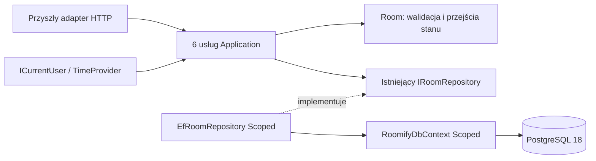
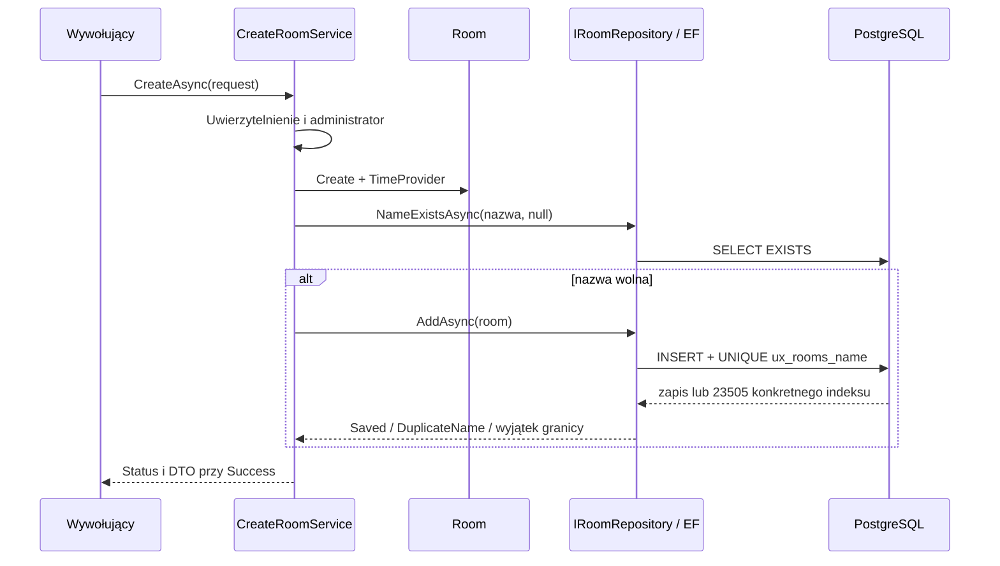
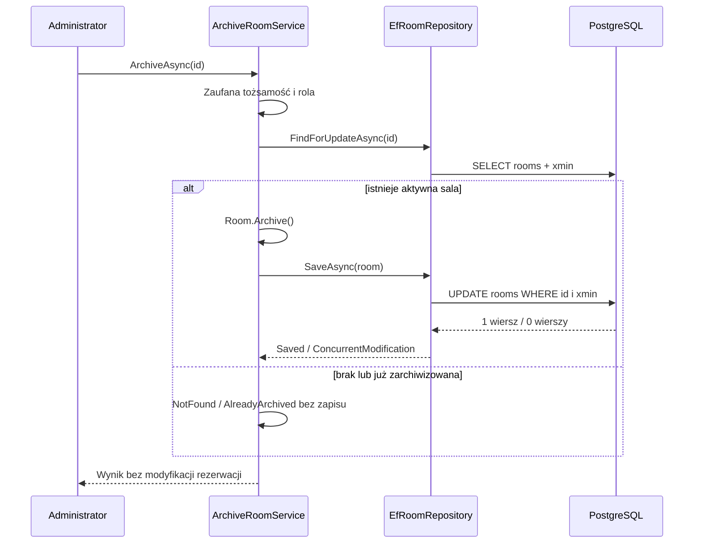

# Zarządzanie salami — WP-03.3

> Aktualizacja WP-03.4: poniższy opis zachowuje zakres poprzedniego etapu. Wspólny ApplicationAccess sprawdza teraz IsActive, a produkcyjny adapter Identity i walidacja cookies co żądanie są zaimplementowane. [Zarządzanie kontami](USER_MANAGEMENT.md), [bieżący raport](../testing/WP03_4_REPORT.md). Produkcyjne endpointy logowania/biznesowe nadal nie istnieją.


Stan: 18.10.2026. Zakres Application/Infrastructure, bez HTTP i Angular. Podstawa: [WP-00](../ai/REQUIREMENTS.md), [reguły](../ai/BUSINESS_RULES.md), istniejący [model Domain](DOMAIN.md) i [rezerwacje](RESERVATION_MANAGEMENT.md). Zlecenie WP-03.3 wybiera implementowane operacje; nie zmienia oznaczeń `[Z]`/`[P]` WP-00.

## 1. Przypadki użycia i kontrakty

| Usługa | Operacja | Dane / wynik |
|---|---|---|
| CreateRoomService | CreateAsync | Name, Description, Location, Capacity; nowa aktywna sala |
| UpdateRoomService | UpdateAsync | RoomId i te same dane; zachowane Id, CreatedAt i IsActive |
| ArchiveRoomService | ArchiveAsync | RoomId; IsActive=false |
| ActivateRoomService | ActivateAsync | RoomId; IsActive=true |
| GetRoomByIdService | GetAsync | RoomId; dozwolone szczegóły |
| GetRoomsService | GetAsync | GetRoomsRequest; strona RoomPage |

RoomDetails zawiera wyłącznie Id, Name, Description, Location, Capacity, IsActive, CreatedAt. Nie zawiera użytkowników, rezerwacji, tokenu xmin ani encji EF. RoomOperationResult<T> stosuje dotychczasową konwencję jawnych statusów i kodów, z Value wyłącznie przy Success. Rozróżnia InvalidInput, Unauthenticated, Forbidden, NotFound, DuplicateName, ConcurrentModification, AlreadyArchived, AlreadyActive i InfrastructureFailure. Request nie przyjmuje ról, UserId, Id nowej sali, CreatedAt ani dowolnego IsActive dla zapisu.

Nie dodano wyposażenia jako nowego modelu ani pola: aktualny Domain i zlecenie ograniczają zapisy do czterech danych. Pełny FR-ROOM-002/005 z wyposażeniem oraz kontrakty HTTP pozostają częściowo zrealizowane.

## 2. Zależności



Application odwołuje się tylko do Domain i DI.Abstractions. Rozbudowano istniejący IRoomRepository, zachowując jego dotychczasową lokalizację w namespace Reservations dla kompatybilności. Nie dodano GenericRepository ani drugiego repozytorium sal. FindByIdAsync i SearchAsync używają AsNoTracking; FindForUpdateAsync zachowuje oryginalną wersję w tracking. Repozytorium nie zna roli użytkownika. Sześć usług rejestruje AddApplication przez TryAddScoped; rejestracja nie wykonuje SQL.

## 3. Tworzenie sali



Domain przycina nazwę/lokalizację/opis; białe Description staje się null. Nazwa 1–100 znaków, lokalizacja 1–150, Capacity>0. Create waliduje przed SQL. Update używa czystego ValidateUpdate przed sprawdzeniem nazwy i mutacją encji; UpdateDetails ponownie broni niezmienników. Nieudana walidacja ani precheck duplikatu nie zmienia śledzonej sali.

## 4. Archiwizacja



## 5. Uprawnienia

Każda usługa wymaga niepustego UserId z ICurrentUser, również gdy flaga administratora jest true. Cztery modyfikacje dodatkowo wymagają IsAdministrator. Zwykły użytkownik czyta aktywne sale; szczegóły nieaktywnej dają takie samo NotFound jak brak rekordu. Administrator czyta także nieaktywne. Żądanie listy IsActive=false przez zwykłego użytkownika daje Forbidden. Bez podanego filtra i z IsActive=true jego lista jest zawsze ograniczona do aktywnych.

Domyślny adapter odmawia dostępu. Brak produkcyjnego adaptera sesji Identity/HTTP i sprawdzania aktywności konta pozostaje ograniczeniem poprzednich etapów. Testy przekazują kontrolowany zaufany kontekst, nie rolę z DTO.

## 6. Filtrowanie

Search wyszukuje fragment Name bez rozróżnienia wielkości liter, przy użyciu LIKE i istniejącej kolacji ICU. Location wyszukuje fragment przez ILIKE. `%`, `_` i `\` w obu filtrach są traktowane dosłownie, przez jawne escapowanie wzorca; wartości są parametrami SQL. MinCapacity jest opcjonalną dodatnią granicą włącznie. Filtry łączą się przez AND. Puste filtry tekstowe nie ograniczają wyników. Administrator może wybrać aktywne, nieaktywne lub wszystkie; Application ustala ostateczny zakres IsActive przed repozytorium.

LIKE z niedeterministyczną kolacją wymaga używanego PostgreSQL 18; [dokumentacja PostgreSQL](https://www.postgresql.org/docs/18/functions-matching.html) potwierdza jego obsługę. ILIKE nie jest stosowane do niedeterministycznej kolacji nazwy. Test sprawdza rzeczywisty SQL i polskie litery, a także dosłowne metaznaki.

## 7. Paginacja i sortowanie

PageNumber>=1, PageSize=1–100 (domyślnie 20); jest to techniczny limit tego API Application, nie nowa reguła WP-00. Offset obliczany w long musi mieścić się w int dla Skip. SortBy to enum: Name, Location, Capacity, CreatedAt; SortDirection: Ascending/Descending. Nieznane wartości enum są odrzucane. Każde sortowanie dodaje Id rosnąco jako drugi, unikalny klucz. Brak interpolacji nazwy kolumny do SQL.

COUNT i projekcja z ORDER BY, OFFSET, LIMIT wykonują się w PostgreSQL. RoomPage zawiera Items, TotalCount, PageNumber, PageSize. Strona poza zakresem jest pusta. Stabilność dotyczy niezmienionego zbioru: równoczesne dodawanie/usuwanie/edycja może przesunąć strony offsetowe, a COUNT i odczyt strony nie tworzą wspólnego snapshotu transakcji. Nie wdrażano paginacji kursorowej ani obietnicy snapshotu.

## 8. Współbieżność i konflikty

Room, analogicznie do Reservation, ma shadow property uint xmin/xid jako IsRowVersion. PostgreSQL aktualizuje tę systemową wartość przy zmianie wiersza. EF zachowuje oryginalne xmin i dodaje je do warunku UPDATE; 0 zmienionych wierszy daje DbUpdateConcurrencyException → ConcurrentModification. Brak automatycznego retry i nadpisywania wygranej wersji. [Mechanizm Npgsql](https://www.npgsql.org/efcore/modeling/concurrency.html) nie wymaga biznesowej właściwości Domain.

Precheck unikalności uwzględnia kolację bazy i pomija własne Id przy Update. Ostateczną ochroną jest ux_rooms_name także dla archiwalnych sal. Wyłącznie 23505 tego indeksu daje DuplicateName. PK, CHECK, inne błędy i awaria połączenia pozostają InfrastructureFailure, bez SQL/connection stringa w wyniku. Zachowano istniejący neutralny ReservationStorageException na granicy starego kontraktu repozytorium. Po nieudanym zapisie kandydat jest odłączany; anulowanie tokenem propaguje OperationCanceledException.

Nowa migracja `20261018111403_RoomOptimisticConcurrency` aktualizuje metadane/snapshot i historię EF. Npgsql nie generuje ADD/DROP COLUMN dla systemowego xmin. InitialCreate i wcześniejsza migracja Reservation są niezmienione. Test upgrade/downgrade działa tylko na bazie Testcontainers, zachowując sale, xmin i rezerwacje. Developerka nadal ma wyłącznie InitialCreate w historii; oba późniejsze wpisy nie zostały zastosowane. Nie wykonano migracji na developerce.

## 9. Dezaktywacja i aktywacja

Archiwizacja to wyłącznie IsActive=false. Nie ma operacji Delete w kontrakcie. Ponowna archiwizacja daje AlreadyArchived bez zapisu. Activate ustawia true, ponowna aktywacja daje AlreadyActive bez zapisu. Edycja danych nie reaktywuje sali. Id i CreatedAt są niezmienne.

## 10. Rezerwacje i ograniczenia

Archiwizacja, aktywacja i zmiana pojemności nie usuwają ani nie anulują rezerwacji: historycznych, przyszłych i już anulowanych. Brak reguły WP-00 nakazującej automatyczne anulowanie. Nieaktywna sala jest odrzucana przez istniejący CreateReservationService; po aktywacji można tworzyć nowe, zgodne z polityką rezerwacje. Cancelled nie wracają do Active. FK Restrict dodatkowo blokuje fizyczne usunięcie sali mającej rezerwacje.

Wcześniejsze ograniczenie nadal obowiązuje: odczyt IsActive przez tworzenie rezerwacji i późniejszy INSERT nie są skoordynowane z równoczesnym Archive. xmin chroni konkurujące zapisy tej samej sali; nie blokuje innej transakcji zapisującej rezerwację. Test zakazu rezerwacji nieaktywnej sali dotyczy zakończonej archiwizacji. Pełna koordynacja tego wyścigu wymaga osobnego zakresu, bez przypisywania jej tu PASS.

## 11. Macierz testów

| Dowód | Zakres |
|---|---|
| Domain RoomActivationTests | Idempotencja aktywacji, tożsamość, czysta walidacja |
| Application RoomManagementTests: 77 przypadków | 6 usług, uprawnienia i brak SQL po odmowie, normalizacja/granice, wyniki, scope filtrów, paginacja, brak mutacji po walidacji |
| RoomApplicationRegistrationTests | Scoped, TryAdd, rozwiązywanie sześciu usług, domyślna odmowa bez SQL |
| INT-ROOM-001/002/003 | Create/read DTO/no tracking, Update i niezmienna historia |
| INT-ROOM-004/005/006/007/013 | Archiwizacja/aktywacja, zachowanie historii i cancelled, blokada rezerwowania/DELETE |
| INT-ROOM-008/009 | SQL filtrów i limitów, osiem sortowań, powtarzalne strony i remisy |
| INT-ROOM-010/011/012 | Wyścig nazw, xmin dwóch administratorów, fizyczne CHECK/długości |
| INT-ROOM-014 + dump przed/po | Izolacja fixture i brak zmiany developerki |
| Dodatkowe PostgreSQL | Role na realnych repozytoriach, konflikt nazwy w Update, klasyfikacja PK/CHECK, migracja up/down |
| Stryker Application | 170 Killed / 171 ocenionych; 99,42%, 1 równoważny Survived |

Dokładne wyniki i 26 kryteriów: [raport WP-03.3](../testing/WP03_3_REPORT.md). Historyczne raporty pozostają bez zmian.

## 12. Uruchamianie

Z katalogu repozytorium, przy uruchomionym Docker Desktop:

```powershell
dotnet restore backend/Roomify.slnx
dotnet build backend/Roomify.slnx -c Debug --no-restore
dotnet build backend/Roomify.slnx -c Release --no-restore
dotnet test backend/tests/Roomify.Domain.UnitTests
dotnet test backend/tests/Roomify.Application.UnitTests
dotnet test backend/tests/Roomify.Api.IntegrationTests --filter "RequiresDocker=false"
dotnet test backend/tests/Roomify.Api.IntegrationTests --filter "RequiresDocker=true"
dotnet ef migrations has-pending-model-changes --project backend/src/Roomify.Infrastructure --startup-project backend/src/Roomify.Infrastructure
```

Stryker uruchamiać **po zakończeniu pozostałych kompilacji**, z katalogu `backend/tests/Roomify.Application.UnitTests`:

```powershell
dotnet stryker --config-file stryker-config.json --output ../../../artifacts/wp033/stryker
```

Konfiguracja obejmuje reguły sal i dotychczasowe reguły rezerwacji. Pomija DTO, DI, migracje i snapshot. Wygenerowane raporty/TRX/logi/SQL trafiają tylko do ignorowanego artifacts. Nie trzeba uruchamiać migracji developerskiej, API ani Angulara do tych testów. Nie wykonywać rollbacku InitialCreate na bazie z danymi.
