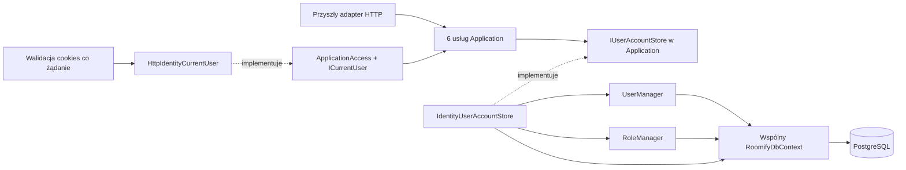
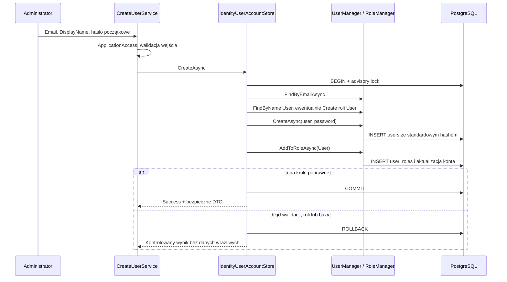
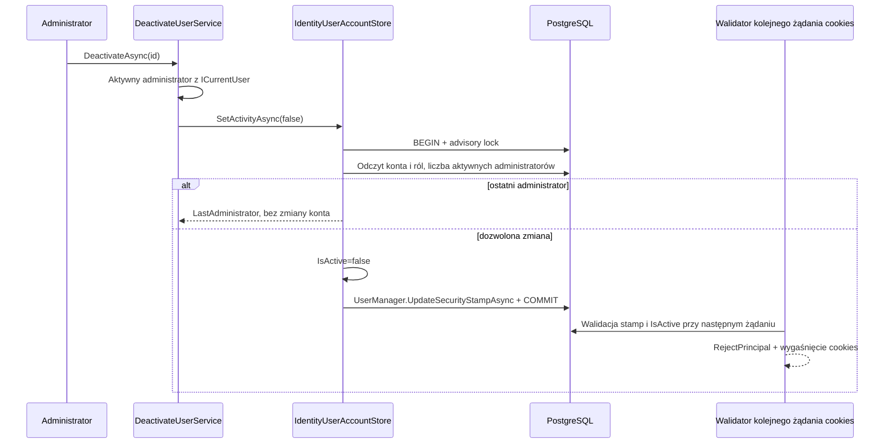

# Zarządzanie kontami i kontrola uprawnień — WP-03.4

Stan: 18.10.2026. Zakres Application/Infrastructure i walidacja istniejącego potoku cookies. Nie dodano endpointów HTTP, publicznej rejestracji ani UI. Podstawa: [WP-00](../ai/REQUIREMENTS.md), [reguły](../ai/BUSINESS_RULES.md), [Identity](IDENTITY.md) i [odbiór WP-03.3](../testing/WP03_3_REPORT.md).

## 1. Przypadki użycia

| Usługa | Operacja i wynik |
|---|---|
| CreateUserService | Email, DisplayName i InitialPassword → aktywny użytkownik z rolą User |
| GetUsersService | Paginowana lista profili, wyszukiwanie Email/DisplayName, aktywność, sortowanie |
| GetUserByIdService | Szczegóły profilu po Guid lub UserNotFound |
| UpdateUserService | Zmiana Email i DisplayName, spójny login i normalizacja Identity |
| DeactivateUserService | IsActive=false, unieważnienie sesji, ochrona ostatniego administratora |
| ActivateUserService | IsActive=true, nowy stamp, hasło/role/historia zachowane |

Wszystkie sześć usług wymaga aktywnego, uwierzytelnionego administratora. Nie ma samoobsługowej edycji profilu ani zarządzania rolami. Model ma DisplayName, nie FirstName/LastName. Powtórna dezaktywacja/aktywacja daje AlreadyInactive/AlreadyActive bez zapisu i bez kolejnego obrotu stempla.

UserDetails zawiera wyłącznie Id, Email, DisplayName, IsActive, CreatedAt. UserPage dodaje Items, TotalCount, PageNumber, PageSize. DTO nie zawierają PasswordHash, SecurityStamp, ConcurrencyStamp, tokenów, lockoutu ani historii logowania. CreateUserRequest nie ma role/IsAdministrator/IsActive/Id. UpdateUserRequest ma docelowy UserId i pola profilu; docelowe ID nie jest tożsamością wykonującego.

## 2. Zależności



Application nadal referencjonuje tylko Domain i DI.Abstractions. Nie zna Identity, EF, Npgsql ani HttpContext. IUserAccountStore jest minimalnym portem administracji kont, bez GenericRepository i bez drugiego magazynu. Adapter oraz usługi są Scoped. Standardowe stores UserManager/RoleManager używają jednego RoomifyDbContext. AddIdentity jest wywoływane raz; rozszerzono jego standardowe punkty SignInManager, claims factory i stamp validator. Nie dodano innego schematu uwierzytelniania.

## 3. Tworzenie konta



Normalizacja Email/UserName pochodzi z Identity. Application przycina Email i DisplayName, sprawdza składnię adresu i techniczną długość 256 zgodną z modelem oraz obecność hasła. Faktyczną politykę hasła weryfikuje UserManager. Pusty DisplayName jest null. Role User można utworzyć przez RoleManager w tej samej transakcji; nie ma seeda kont ani administratora.

Wstępny FindByEmail nie zastępuje indeksu ux_users_normalized_email. Fizyczna unikalność i test dwóch równoległych prób gwarantują brak duplikatu. Tworzenie oraz zmiany aktywności używają stałego advisory lock transakcyjnego, więc bootstrap roli i policzenie administratorów nie ścigają się między instancjami aplikacji. Na potrzeby niewielkiego MVP jest to globalna serializacja tych krótkich operacji, nie blokada procesu w pamięci. Aktualizacje profilu nie są serializowane tym lockiem.

## 4. Dezaktywacja



Blokada obejmuje policzenie i zapis. Dwie jednoczesne dezaktywacje dwóch ostatnich administratorów zostawiają jednego aktywnego; przegrana daje LastAdministrator. Samodezaktywacja administratora jest możliwa tylko przy innym aktywnym administratorze. Nie ma operacji usuwania ani zmiany ról. Ochrona dotyczy wspieranych przypadków użycia; przyszłe zmiany ról/seed/modyfikacje bezpośrednie muszą respektować ten sam niezmiennik.

## 5. Role i brak eskalacji

Tworzenie zawsze przypisuje stałą rolę **User**. Nie ma pola Role, RoleIds ani IsAdministrator w requestach. WP-00 pozostawia dowolne zarządzanie rolami otwarte, więc nie zaimplementowano nadawania Administrator przez Application. Role wykonującego pochodzą z principal wygenerowanego przez Identity z bazy. Domyślna tożsamość bez HTTP odmawia dostępu.

Nie tworzy się automatycznie administratora ze stałym hasłem. Pierwsze konto administracyjne wymaga osobno zaprojektowanego, kontrolowanego bootstrapu. Istniejąca developerka pozostaje bez nowych kont i ról; brak login endpointu nadal uniemożliwia użytkowanie tej funkcji przez produkt HTTP.

## 6. Hasła

Użyto standardowego PasswordHasher i walidatorów Identity: minimum 12 znaków, cyfra, mała i wielka litera; znaki specjalne nie są obowiązkowe. Request przekazuje hasło wyłącznie do UserManager.CreateAsync. Kod nie loguje requestów ani haseł. CreateUserRequest.ToString zwraca tylko nazwę typu; wynik i DTO nie zawierają hasła. Nie ma wysyłki e-mail, resetu hasła, własnego algorytmu hashowania ani stałego hasła konta administracyjnego.

Zlecenie wymaga bezpiecznego kanału przekazania początkowego hasła; kanał HTTP jeszcze nie istnieje. Przyszły endpoint musi stosować HTTPS i wykluczać treść requestu z logowania. Zmiana aktywności i profilu nie zmienia PasswordHash.

## 7. Wspólna kontrola dostępu i odczyty

ApplicationAccess.Check najpierw rozpoznaje brak/Guid.Empty tożsamości jako Unauthenticated, następnie brak IsActive lub wymaganej roli jako Forbidden. Używają go rezerwacje WP-03.1/03.2, RoomRules z WP-03.3 i wszystkie operacje kont. Właściciel/admin rezerwacji oraz aktywność sal zachowują dotychczasowe reguły. Nie zmieniono logiki terminów.

ICurrentUser.IsActive domyślnie wynosi **false**: nowy adapter musi jawnie potwierdzić aktywność. Poprzednie zaufane helpery testowe rozszerzono o true bez zmiany asercji biznesowych. HttpIdentityCurrentUser czyta tylko uwierzytelniony principal, zaufane Guid, role Identity i serwerowy claim roomify:active. Claims factory usuwa potencjalny zapisany claim o tej zarezerwowanej nazwie i ustawia go na podstawie IsActive konta. Walidacja cookies odświeża dane z bazy na każdym żądaniu. Jawny adapter hosta/testu zarejestrowany wcześniej nie jest nadpisywany; produkcyjny zastępuje wyłącznie domyślną odmowę.

Lista kont filtruje PostgreSQL przez parametr Search w Email lub DisplayName (ILIKE, escapowane `%`, `_`, `\`) oraz opcjonalny IsActive. PageNumber>=1, PageSize 1–100, domyślnie 20. Błędny offset/enum odrzuca Application. SortBy: Email, DisplayName, CreatedAt, kierunek rosnący/malejący, zawsze Id rosnąco jako drugi klucz. Nie dodano filtrów ról ani osobnych pól imienia/nazwiska. COUNT i SELECT projekcji z OFFSET/LIMIT nie pobierają całej tabeli ani poufnych kolumn. Stabilność stron dotyczy stałego zbioru; brak wspólnego snapshotu COUNT/strony przy równoczesnych zmianach.

## 8. Sesje i logowanie

ActiveAccountSignInManager rozszerza CanSignInAsync o IsActive, zachowując bazowe sprawdzenia Identity. Testuje się rzeczywiste CheckPasswordSignInAsync, nie publiczny endpoint logowania.

ActiveAccountStampValidator zachowuje standardowe sprawdzenie SecurityStamp przez SignInManager i sprawdza IsActive **przy każdym uwierzytelnionym żądaniu**. Nie czeka na dawny interwał 5 minut; skonfigurowano TimeSpan.Zero, a sam walidator nie pomija kontroli przy identycznej chwili zegara. Brak stempla, brak konta, zmieniony stamp lub nieaktywność odrzuca principal i wygasza cookies. Błąd bazy nie dopuszcza operacji chronionej; nie wprowadzono trybu zaufania do starego principal podczas awarii.

Po poprawnej walidacji standardowy mechanizm odświeża principal i role. Zachowano HttpOnly, SameSite=Lax, Secure poza lokalnym HTTP Development, 30 minut i brak sliding expiration. Ponowne wystawienie biletu podczas walidacji nie przedłuża końcowej daty ważności. Mechanizm wymaga odczytów Identity na każde żądanie; to świadomy koszt natychmiastowej kontroli.

Deactivate zmienia IsActive i stamp w jednym zapisie Identity. Activate ponownie zmienia stamp i nie odtwarza starych sesji. Każdy Update profilu również obraca stamp, konserwatywnie unieważniając dotychczasowe sesje. Odrzucenie dotyczy następnego żądania po commit; już wykonywanych operacji nie cofa. Same cookies nie zastępują przyszłej ochrony CSRF/TLS/trwałego key ring.

## 9. Historia, transakcje i współbieżność

Żadna operacja kont nie usuwa użytkownika, ról ani rezerwacji. Snapshot rezerwacji przed/po aktywności pozostaje identyczny. Nie anuluje się automatycznie przyszłych rezerwacji nieaktywnego konta. Aktywacja zachowuje Id/CreatedAt/hasło/przypisane role i nie odtwarza anulowanych rezerwacji.

Create, Update i SetActivity obejmuje transakcja jednego DbContext. UserManager.SetEmailAsync i SetUserNameAsync utrzymują poprawne Email/UserName/NormalizedEmail/NormalizedUserName. Jeżeli drugi krok odrzuci login, rollback cofa również wcześniejszy zapis e-maila i stempla. Test wykorzystuje poprawny adres z `!`, niedozwolonym w domyślnym UserName Identity. Nie zastąpiono managerów bezpośrednim zapisem EF.

Profile chroni standardowy ConcurrencyStamp Identity: dwie śledzone migawki tego samego konta dają jednego zwycięzcę, jeden ConcurrentModification. Nie ma klientowego parametru SecurityStamp/ConcurrencyStamp; przed przyszłym HTTP trzeba osobno zdecydować o wersji/ETag dla długiego procesu formularza. Bieżąca ochrona obejmuje konkurencyjne zapisy z odczytaną wersją w zakresie operacji, tak jak poprzednie przypadki użycia.

Po niepowodzeniu transakcja jest wycofywana, a encje operacji odłączane, aby późniejsze SaveChanges nie ponowiło częściowego zapisu. Kod nie używa Delete/EnsureDeleted/ChangeTracker.Clear ani nie cofa cudzych zapisanych danych. Ponieważ stores Identity wywołują SaveChanges, adapter wymaga kontekstu bez oczekujących zmian; host powinien wykonywać jeden przypadek użycia w świeżym zakresie. Token anulowania propaguje OperationCanceledException i zapobiega commitowi, zamiast stawać się błędem walidacji.

Schemat, encje i mapowania nie wymagały zmiany. Nie dodano migracji; snapshot i poprzednie migracje pozostają identyczne. Historia developerki nadal ma tylko InitialCreate, a niewdrożone dwa mapowania xmin są odrębnym ostrzeżeniem wcześniejszych etapów.

## 10. Wyniki i błędy Identity

Jeden UserOperationResult<T> dla sześciu usług stosuje konwencję dotychczasowego Result pattern: Status, Value przy Success, ErrorCode przy błędzie, bez HTTP w Application. Nazwy wyników: Success, InvalidInput, Unauthenticated, Forbidden, UserNotFound, DuplicateEmail, AlreadyInactive, AlreadyActive, ConcurrentModification, LastAdministrator, InfrastructureFailure.

IdentityResult mapuje się po kodach, bez przekazywania Description ani wewnętrznych danych. ConcurrencyFailure → ConcurrentModification, DuplicateEmail/DuplicateUserName → DuplicateEmail przy loginie zawsze równym e-mailowi. Znane błędy walidacji hasła/adresu/loginu → InvalidInput. Nieudane przypisanie roli → InfrastructureFailure i rollback. PostgreSQL 23505 wyłącznie ux_users_normalized_email/ux_users_normalized_user_name daje DuplicateEmail. Inne błędy i awarie → neutralne user.storageFailure. Nie wykonuje się automatycznego retry ani destrukcyjnego usuwania nowego konta jako namiastki rollbacku.

## 11. Testy i granice dowodu

| Scenariusz | Dowód |
|---|---|
| 6 operacji, admin/gość/nieaktywność, walidacja i DTO | UserManagementTests w Application, xUnit/Moq, bez Dockera |
| Odmowa konta nieaktywnego w WP-03.1–03.3 | Jednostkowe wywołanie wszystkich 9 istniejących usług, brak wywołań repozytoriów |
| INT-USR-001/002/003/014 | Realny UserManager, hash i weryfikacja hasła, tylko User, bezpieczne DTO |
| INT-USR-004 | Równoległe Create, dokładnie 1 konto, fizyczny unikalny indeks |
| INT-USR-005/006 | Spójny e-mail/login/normalizacja, rollback częściowego Update, konflikt ConcurrencyStamp |
| INT-USR-007/008/009 | Zachowane konta/role/hasło i pełny snapshot rezerwacji, nowy stamp |
| INT-USR-010/011 | CheckPasswordSignInAsync i rzeczywisty testowy potok cookies: 200/403 przed, 401 po, stary bilet nadal 401 po aktywacji, nowy 200 |
| INT-USR-012/013 | Realne repozytoria i kontrolowana zaufana tożsamość, 4 kombinacje dostępu |
| INT-USR-015 | Izolacja fixture i porównanie dumpa developerki przed/po pełnej regresji |
| Ostatni administrator | Dwie konkurencyjne dezaktywacje, 1 Success + 1 LastAdministrator |
| Lista | 6 sortowań, remisy, strony, SQL filtrów i projekcji bez poufnych kolumn |
| DI/awaria | 6 Scoped usług, jeden kontekst/adapter, brak SQL przy domyślnej odmowie, neutralne błędy bazy |

Kontrolery `/__tests/accounts/*` są wyłącznie w testowym assembly i dodawane przez WebApplicationFactory. Test issue/{id} wystawia bilet na potrzeby testu; nie jest produkcyjnym logowaniem. Produkcyjny host nadal zwraca 404 dla auth/rejestracji/biznesowych tras. Testy nie oznaczają kompletnego przepływu login HTTP jako PASS. Szczegóły i pełna tabela AC: [raport](../testing/WP03_4_REPORT.md).

## 12. Uruchomienie

Z katalogu repozytorium, z Docker Desktop dla drugiego filtra:

```powershell
dotnet restore backend/Roomify.slnx
dotnet build backend/Roomify.slnx -c Debug --no-restore
dotnet build backend/Roomify.slnx -c Release --no-restore
dotnet test backend/tests/Roomify.Domain.UnitTests
dotnet test backend/tests/Roomify.Application.UnitTests
dotnet test backend/tests/Roomify.Api.IntegrationTests --filter "RequiresDocker=false"
dotnet test backend/tests/Roomify.Api.IntegrationTests --filter "RequiresDocker=true"
dotnet ef migrations has-pending-model-changes --project backend/src/Roomify.Infrastructure --startup-project backend/src/Roomify.Infrastructure
```

Testcontainers tworzy własne bazy/użytkownika/losowe hasło/port, nie czyta .env i nie montuje developerki. Wyniki zapisywać w ignorowanym artifacts/wp034. Opcjonalny Stryker: z `backend/tests/Roomify.Application.UnitTests` polecenie `dotnet stryker --config-file stryker-config.json --output ../../../artifacts/wp034/stryker`; uruchamiać po zakończeniu innych buildów. Domyślna konfiguracja zawiera wspólny ApplicationAccess i reguły użytkowników obok sal/rezerwacji, bez DTO/DI/migracji. Nie uruchamiać migracji ani operacji destrukcyjnych na developerce w ramach testów. WP-03.5 wymaga osobnego zlecenia.

Dokumentacja źródłowa mechanizmu: [konfiguracja Identity i security stamp](https://learn.microsoft.com/en-us/aspnet/core/security/authentication/identity-configuration?view=aspnetcore-10.0), [SecurityStampValidator 10.0.9](https://github.com/dotnet/aspnetcore/blob/v10.0.9/src/Identity/Core/src/SecurityStampValidator.cs). Opis działania Roomify powyżej odpowiada implementacji i testom, nie samym ustawieniom standardowego interwału.
