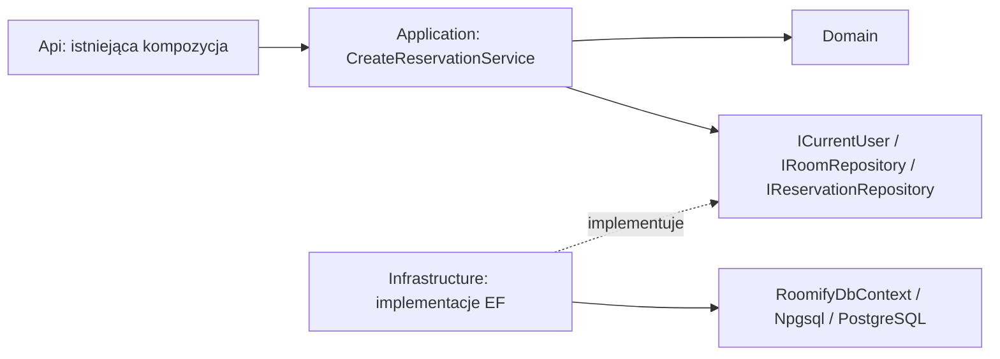

# WP-03.1 — tworzenie rezerwacji i dostępność

**18.10.2026: WP-03.1 wykonane, 26/26 AC PASS w opisanym zakresie.** Nie rozpoczęto WP-03.2, nie wykonano commit ani push. [Architektura, modele, repozytoria i diagramy](../architecture/RESERVATION_APPLICATION.md) oraz [macierz wymagań](REQUIREMENTS_TRACEABILITY.md) stanowią część przekazania.

## Implementacja i zgodność

CreateReservationService jest pierwszym przypadkiem użycia Application. Wejście ma RoomId, Title, StartAt, EndAt; **nie ma UserId**. Właściciel pochodzi wyłącznie z ICurrentUser. Default jest nieuwierzytelniony i bez podłączonego zaufanego adaptera nie pozwala tworzyć rezerwacji. Nie dodano logowania ani odczytu HttpContext/claims.

Przed bazą Domain tworzy i waliduje kandydata (bez trackowania/zapisu), następnie Application sprawdza salę i IsActive, wykonuje precheck dostępności, zapisuje przez Infrastructure i zwraca Success dopiero po SaveChanges. Wykorzystano istniejące Reservation.Create/ReservationPeriod i TimeProvider; nie kopiowano walidacji tytułu/czasu ani nie zmieniono Domain. Reguły: BR-001/002/003/004/006/007/008/009/010/014/015/016/022/024/026, część BR-013/019 dotycząca istniejącej aktywnej sali. Aktywność konta i polityki sesji nadal należą do przyszłej integracji Identity; BR-013/021 nie są oznaczone jako w pełni spełnione.

EfRoomRepository pobiera pojedynczą salę po PK bez śledzenia. EfReservationRepository wykonuje **AnyAsync → SELECT EXISTS** dla room_id, status=active, StartAt < End i EndAt > Start, bez pobierania listy i bez filtra dnia. Zapis to Add i SaveChanges w Scoped DbContext, z końcową ochroną istniejącego exclusion GiST. Nie użyto procesu lock ani GenericRepository/nowego frameworka. Nie dodano migracji; InitialCreate/designer/snapshot i wymagania WP-00 pozostają bez zmian.

Wyniki rozróżniają Success, InvalidInput, RoomNotFound, RoomInactive, Conflict, Unauthenticated i InfrastructureFailure, bez HTTP/SQL/connection stringa/wyjątków providera. Tylko **23P01 + ex_reservations_active_period** daje Conflict. Inny constraint, FK, deadlock, błąd połączenia itd. pozostają odrębnym InfrastructureFailure; anulowanie jest propagowane. Po nieudanym zapisie własny kandydat jest odłączany od trackera.

## Zależności i DI

Application nadal ma jedynie referencję Domain i DI.Abstractions 10.0.0, bez EF/Identity/ASP.NET Core. Domain nie ma zależności infrastrukturalnych. Scoped: serwis, domyślny ICurrentUser i oba repozytoria/DbContext. Singleton: TimeProvider.System, możliwy jawny override. TryAdd zachowuje podłączony adapter/zegar i nie duplikuje usług Application. Kompozycję i brak zapytań podczas rejestracji/rozwiązania potwierdzono bez Dockera. Program.cs i endpointy pozostały bez zmian.

## Rzeczywiste wyniki weryfikacji

| Kontrola | Wynik |
|---|---|
| dotnet restore backend/Roomify.slnx | PASS; dodano wyłącznie Moq 4.20.72 do projektu testów Application, ze standardowymi zależnościami przechodnimi |
| Debug / Release całego rozwiązania | PASS, 0 ostrzeżeń i błędów |
| Domain | **110/110 PASS**, 0 failed/skipped; runner 77 ms |
| Application | **32/32 PASS**, 0 failed/skipped; runner 180 ms w pełnej regresji |
| Wszystkie integracyjne | **138/138 PASS**, 0 failed/skipped; runner 20 s |
| W tym bez Dockera | **75/75 PASS** (dawne 72 + 3 kompozycji/awarii połączenia) |
| W tym PostgreSQL | **63/63 PASS** (dawne 42 + 21 nowego przypadku użycia) |
| Razem końcowy zbiór backendu | **280/280 PASS** (110 + 32 + 138) |
| Nowy podzbiór ReservationApplication / ApplicationComposition | **24/24 PASS**, 21 z PostgreSQL i 3 bez Dockera, także wykonany osobno |
| has-pending-model-changes | PASS: brak zmian modelu względem migracji |
| Stryker Application | **100,00%**, 19 Killed / 19 badanych, 0 Survived/NoCoverage/Timeout/RuntimeError |
| Dane developerskie | Logicznym dumpem i historią potwierdzono brak zmian |
| Git / sekrety / referencje | Kontrola kandydatów, ignorowania artefaktów i źródeł; bez commit/push |

Czasy sesji TRX końcowej regresji (z uruchomieniem runnera): Domain 0,756 s, Application 0,830 s, integracyjne 21,724 s. To odrębna miara od czasu samych przypadków wypisanego przez runner. Nie sumujemy dodatkowych przebiegów jako nowych przypadków. Wyniki wynikają z rzeczywistych TRX pod artifacts/wp031/regression.

Nie powtarzano frontend/E2E/manualnych, pomiaru coverage ani mutacji Domain. Historyczny odbiór WP-02 pozostaje odrębnym raportem. Działające kontenery Compose nie zostały w tym etapie przebudowane dla nowego kodu; dowód implementacji to lokalne buildy i testy, nie deklaracja wdrożenia do obrazu API.

## Testy Application

32 przypadki xUnit/Moq, bez prawdziwej bazy i Dockera:

- Poprawny request zapisuje dokładnie raz, zachowuje zaufany UserId, UTC, trim, status i metadane; token dochodzi do repozytoriów.
- 14 wariantów niepoprawnych danych: null request, Guid.Empty sali, brak/pusty/długi tytuł, równy/odwrócony okres, przeszłość/równość z teraz, ponad 8 h, przed/po godzinach, precyzja i lokalny dzień. Repozytoria nie są wywoływane.
- Dwie postacie braku tożsamości; brak możliwości przekazania UserId w kontrakcie.
- Sala brakująca/nieaktywna nie powoduje sprawdzania dostępności ani zapisu.
- Siedem wariantów dostępności w mocku korzystającym z rzeczywistego Domain.Blocks: identyczne/całkowite/częściowe nakładanie, styk z obu stron, cancelled i inna sala. Faktyczną translację SQL potwierdzają osobne testy PostgreSQL, nie te mocki.
- Repozytorium może zgłosić Conflict mimo wcześniejszej dostępności; trzy granice awarii dają InfrastructureFailure; anulowanie jest propagowane.

## Testy PostgreSQL INT-RES-001–009

| ID | Scenariusz i dowód — końcowo PASS |
|---|---|
| INT-RES-001 | Wolny termin: cały serwis, rzeczywiste DI/repozytoria/SaveChanges, ponowny odczyt UTC/statusu/danych; interceptor potwierdza EXISTS i warunki zakresu |
| INT-RES-002 | 5 układów nakładania: przed/po, zawierający, zawarty i identyczny; kontrolowany Conflict, tylko stary rekord, brak kandydata w trackerze |
| INT-RES-003 | 2 styki: przed i po istniejącej rezerwacji, Success i 2 rekordy |
| INT-RES-004 | Cancelled nie blokuje; nowy Active, zachowany stary rekord |
| INT-RES-005 | Sala zarchiwizowana odrzucona jako RoomInactive, bez zapisu |
| INT-RES-006 | Poprawny nieistniejący Guid sali daje RoomNotFound, bez zapisu |
| INT-RES-007 | 6 powtórzeń, dwa zakresy DI/DbContext/połączenia, bariera po realnym precheck, jeden Success i jeden odrzucony, 1 aktywny wiersz |
| INT-RES-008 | Inne połączenie zajmuje termin po realnym SELECT; SaveChanges zwraca właściwy 23P01 → Conflict; kandydat odłączony, ponowne SaveChanges zapisuje 0 |
| INT-RES-009 | 2 błędy niebędące konfliktem terminu: usunięty użytkownik → FK 23503; inny exclusion ex_test_title → 23P01. Oba dają InfrastructureFailure, nie Conflict |

Dodatkowo ta sama godzina w innej sali przechodzi. Razem 21 przypadków PostgreSQL w nowej klasie. Wszystkie wykorzystują rzeczywistą InitialCreate i osobną bazę z fixture Testcontainers postgres:18.6-bookworm. Dodatkowe ograniczenie ex_test_title i usunięcie technicznego użytkownika występują **tylko w prywatnych bazach testów negatywnych**, nie w migracji ani developerce.

## Współbieżność: rzeczywiste wyniki

Każda próba używa dwóch niezależnych zakresów i połączeń. Testowy dekorator czeka po rzeczywistym odczycie wolnego terminu przez obie strony, dopiero wtedy dopuszcza współbieżne INSERT-y. Nie ma Task.Delay ani oczekiwania na commit pierwszej operacji przed rozpoczęciem drugiej. Limit to 20 s. Testowy interceptor przechwytuje rzeczywisty SQLSTATE; wynik aplikacyjny musi odpowiadać temu kodowi, a baza zawierać dokładnie jeden Active. Nieznany błąd/timeout/dwa sukcesy powodują FAIL.

| Próba | Poprawny podzbiór — A / B / kod odrzucenia | Końcowa pełna regresja — A / B / kod | Aktywne |
|---|---|---|---:|
| 1 | Success / Conflict / 23P01 | Conflict / Success / 23P01 | 1 |
| 2 | Success / Conflict / 23P01 | Success / Conflict / 23P01 | 1 |
| 3 | Success / Conflict / 23P01 | Conflict / Success / 23P01 | 1 |
| 4 | Conflict / Success / 23P01 | Conflict / Success / 23P01 | 1 |
| 5 | InfrastructureFailure / Success / 40P01 | Conflict / Success / 23P01 | 1 |
| 6 | Conflict / Success / 23P01 | Success / Conflict / 23P01 | 1 |

W dwóch poprawnych seriach: **12 scenariuszy, 24 wywołania serwisu, 12 sukcesów i 12 kontrolowanych odrzuceń** (11 × Conflict/23P01, 1 × InfrastructureFailure/40P01), zero podwójnych zapisów i timeoutów. Końcowa seria: 6 × para Success/Conflict. Istniejące 12 scenariuszy MIG-010 również przeszło w pełnej regresji; powyższe liczby dotyczą osobno nowego przypadku użycia.

40P01 nie jest 23P01 i nie jest maskowane jako Conflict. Repozytorium nie wykonuje nieograniczonego ani automatycznego retry. Planowanie ponowienia całej operacji/transakcji pozostaje jawnym ograniczeniem. Exclusion chroni integralność także przy takim odrzuceniu.

## Historia niepowodzeń i napraw

Pierwszy podzbiór nowych testów: **21 PASS / 2 FAIL z 23**, bez skipped. Zachowano artifacts/wp031/reservation-application.log i trx/reservation-application.trx.

1. Jedna próba INT-RES-007 dostała prawdziwy 40P01 opakowany przez NpgsqlExecutionStrategy w InvalidOperationException → DbUpdateException → PostgresException. Początkowa granica Infrastructure przechwytywała wyłącznie bezpośredni błąd DB/EF i wyjątek wydostał się poza nią. **Naprawiono** wspólny klasyfikator błędów persystencji, bez uznawania wszystkich InvalidOperationException za błędy bazy ani wszystkich DbUpdateException za konflikt. Ponowne serie potwierdziły obsługę zarówno 23P01, jak i 40P01.
2. INT-RES-009 porównywał tytuł z testowego INSERT zawierający skrajne spacje ze znormalizowanym tytułem nowego kandydata. Inny exclusion prawidłowo nie widział równości, więc test niesłusznie oczekiwał awarii. **Naprawiono przygotowanie danych** przez ten sam trim wartości; asercje właściwego błędu i braku maskowania pozostały.

Dodano również test awarii rzeczywistego odczytu na nieosiągalnym lokalnym porcie 1, bez Dockera: wynik to neutralny InfrastructureFailure. Po poprawkach podzbiór **24/24**, następnie cały backend **280/280**. Pierwszych wyników nie nadpisano poprawnymi.

## Mutacje nowej logiki Application

Lokalny Stryker.NET 5.0.0, bez aktualizacji istniejących narzędzi. Nowa konfiguracja projektu Application.UnitTests wybiera tylko **Reservations/CreateReservationService.cs** — warunki walidacji/tożsamości, stan sali, precheck, wynik zapisu i obsługę błędów. DTO, proste DI, repozytoria EF, migracje i kod wygenerowany nie są badanym zakresem. Analiza dotyczy tej wersji serwisu; późniejsza poprawka dotyczyła Infrastructure, nie zmieniła badanego źródła.

Wynik narzędzia: **100,00%**, **19/19 Killed**, 0 Survived, 0 NoCoverage, 0 Timeout, 0 RuntimeError; czas 17,267 s. Brak listy niewykrytych, ponieważ w tym zakresie nie było Survived. Nie jest to 100% skuteczności całego rozwiązania ani całej infrastruktury.

Jawna różnica raportów Stryker 5.0.0: log podaje **29 wygenerowanych, 5 CompileError i 5 Ignored przez mutate filter**; JSON zawiera **28 wpisów** (ID 0–27), w tym **19 Killed, 5 CompileError i 4 Ignored**. Cztery jawne Ignored w JSON dotyczą wyłączonej prostej konfiguracji DI. Dodatkowego wpisu licznika logu nie ma w JSON; nie dopisujemy mu fikcyjnego statusu ani nie uznajemy za Killed. Oba źródła zgodnie podają 19 badanych/wykrytych, więc score wynosi 19/19. Pięć CompileError to usunięcia bloków skutkujące brakiem zwrotu/niezainicjowaną zmienną w syntetycznym mutancie, nie błędy zwykłego builda. Nie zmieniano filtrów dla poprawy wyniku. [Definicje stanów Stryker](https://stryker-mutator.io/docs/mutation-testing-elements/mutant-states-and-metrics/).

HTML: `artifacts/wp031/mutation-application/reports/mutation-report.html`; JSON obok, log `artifacts/wp031/stryker-application.log`. Pomiaru pokrycia i analizy mutacyjnej Domain nie powtarzano; wcześniejsze 93,46% i coverage Domain zachowują historię WP-02.5, nie są nowym pomiarem WP-03.1.

## Bezpieczeństwo danych i architektury

Baseline przed implementacją obejmuje 154 kandydatów Git i developerski dump. Po wszystkich testach logiczny pg_dump (bez owner/privileges, z normalizacją wyłącznie losowych linii restrict/unrestrict) ma **identyczny SHA-256: be2f8674ec8f1819e2ba85f5f90a5dcbdf1cd01f511d08b268904004f984f280**. Historia nadal `20261018093445_InitialCreate|10.0.9`. Nie wykonywano developer database update/rollback, seedów, kasowania tabel ani wolumenów. Bazy testowe nie odczytują .env, mają connection string z Testcontainers i brak developerskiego wolumenu; po wykonaniu nie ma kontenerów testowych.

Końcowo Compose db i api healthy, frontend running. Nie przebudowywano w tym pakiecie kontenerów; nie utożsamiamy tego stanu z wdrożeniem nowego Application. Sekrety .env nie są ujawniane w kodzie ani dodawane do repozytorium. Artefakty, bin/obj i node_modules pozostają ignorowane, staging pusty. Przed zamknięciem wykonano git status, kontrolę kandydatów, sekretów, chronionych źródeł i git diff --check. Wcześniejsze niezatwierdzone zmiany pozostawiono.

## Kryteria akceptacji

| AC | Status | Dowód |
|---|---|---|
| AC-001 | PASS | CreateReservationService i rzeczywisty zapis INT-RES-001 |
| AC-002 | PASS | Application.csproj: Domain + dotychczasowe DI.Abstractions, bez Infrastructure |
| AC-003 | PASS | Niezmienione Domain/Domain.csproj, bez EF/HTTP |
| AC-004 | PASS | 14 wariantów wejścia Application, Domain.Create/Period; brak odczytu/zapisu po walidacji |
| AC-005 | PASS | FindById + IsActive, testy jednostkowe i INT-RES-005/006 |
| AC-006 | PASS | Istniejąca polityka czasu użyta bez duplikacji, testy Application i Domain 110/110 |
| AC-007 | PASS | EXISTS: active/room/overlap; INT-RES-002, przypadki mocków |
| AC-008 | PASS | INT-RES-003 i dwie granice w Application |
| AC-009 | PASS | INT-RES-004 i cancelled w Application |
| AC-010 | PASS | ICurrentUser; brak UserId w request, test kontraktu i zapisanego właściciela |
| AC-011 | PASS | EfReservationRepository, rzeczywiste SaveChanges i round-trip |
| AC-012 | PASS | INT-RES-007: jeden sukces i aktywny rekord; istniejący exclusion |
| AC-013 | PASS | INT-RES-008: rzeczywiste 23P01/właściwa ConstraintName → Conflict |
| AC-014 | PASS | INT-RES-009 FK i inny 23P01; odrębne 40P01/awaria połączenia |
| AC-015 | PASS | 3 nowe testy kompozycji/awarii, zakresy i override, brak DB przy rejestracji |
| AC-016 | PASS | Application 32/32, Moq/xUnit, bez prawdziwej bazy |
| AC-017 | PASS | 63/63 PostgreSQL w pełnym przebiegu, nowe 21/21 |
| AC-018 | PASS | 6/6 nowych prób w każdym z dwóch poprawnych przebiegów; dawne MIG-010 także PASS |
| AC-019 | PASS | Domain 110/110, żadnego usuniętego/osłabionego testu |
| AC-020 | PASS | Debug bez ostrzeżeń/błędów |
| AC-021 | PASS | Release bez ostrzeżeń/błędów |
| AC-022 | PASS | RESERVATION_APPLICATION.md: 12 tematów, diagramy, kontrakty, kody i granice |
| AC-023 | PASS | REQUIREMENTS_TRACEABILITY.md z bieżącymi FR/BR i ograniczeniami |
| AC-024 | PASS | Bez kontrolera, auth HTTP, UI, CRUD, edycji/anulowania Application i nowych migracji |
| AC-025 | PASS | Identyczny logiczny dump i historia przed/po, sprzątnięte Testcontainers |
| AC-026 | PASS | Rzeczywiste wyniki i historia pierwszego niepowodzenia w tym raporcie |

## Pliki tego pakietu

- `backend/src/Roomify.Application/Abstractions/ICurrentUser.cs` — kontrakt tożsamości i bezpieczny domyślny adapter.
- `backend/src/Roomify.Application/Reservations/CreateReservationModels.cs` — wejście, rezultat, statusy i dane utworzonej rezerwacji.
- `backend/src/Roomify.Application/Reservations/CreateReservationService.cs` — przypadek użycia.
- `backend/src/Roomify.Application/Reservations/ReservationContracts.cs` — repozytoria, wynik zapisu i neutralny wyjątek granicy.
- `backend/src/Roomify.Application/ApplicationServiceCollectionExtensions.cs` — rejestracja Application.
- `backend/src/Roomify.Infrastructure/Persistence/Repositories/EfRoomRepository.cs`, `EfReservationRepository.cs`, `ReservationPersistenceErrors.cs` — dostęp do danych i klasyfikacja błędów.
- `backend/src/Roomify.Infrastructure/InfrastructureServiceCollectionExtensions.cs` — Scoped repozytoria.
- `backend/tests/Roomify.Application.UnitTests/Roomify.Application.UnitTests.csproj` — Moq 4.20.72.
- `backend/tests/Roomify.Application.UnitTests/CreateReservationServiceTests.cs`, `stryker-config.json` — 32 przypadki i mutacje nowej logiki.
- `backend/tests/Roomify.Api.IntegrationTests/ReservationApplicationTests.cs`, `ReservationApplicationRegistrationTests.cs` — 21 PostgreSQL + 3 kompozycji/awarii.
- `docs/architecture/RESERVATION_APPLICATION.md`, `docs/testing/WP03_1_REPORT.md` — architektura i raport.
- Status, macierz, README oraz dokumentacja testów/architektury — aktualny zakres przy zachowaniu historii WP-02.

## Ograniczenia i przekazanie do WP-03.2

Brak adaptera HTTP ICurrentUser i logowania jest celowy; domyślne wywołanie jest Unauthenticated. Zaufany adapter i przyszłe endpointy muszą egzekwować aktywność konta oraz bezpieczeństwo sesji/CSRF. Nie ma tu autoryzacji odczytu/edycji/anulowania ani kalendarza. Sprawdzenie aktywności sali nie jest nowym protokołem współbieżności z przyszłą archiwizacją. Scoped DbContext służy pojedynczemu przypadkowi użycia i nie powinien zawierać cudzych oczekujących zmian.

40P01 daje kontrolowany InfrastructureFailure; nie ma automatycznego retry ani gwarancji, że każde odrzucenie wyścigu będzie statusem Conflict. Nie ujawnia się SQLSTATE klientowi Application. Rozbieżność licznika wygenerowanych/wykluczonych mutantów między logiem i JSON jest jawna; mierzalny score wybranego serwisu 100% nie jest wynikiem całego systemu. Brak nowych blokad środowiskowych lub otwartego błędu integralności w wymaganym zakresie. **WP-03.2 może otrzymać działający przypadek użycia i kontrakty, lecz nie rozpoczęto go automatycznie.**
